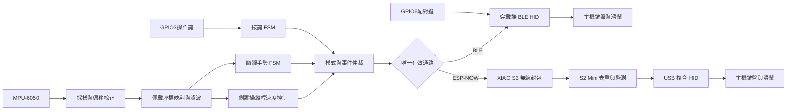
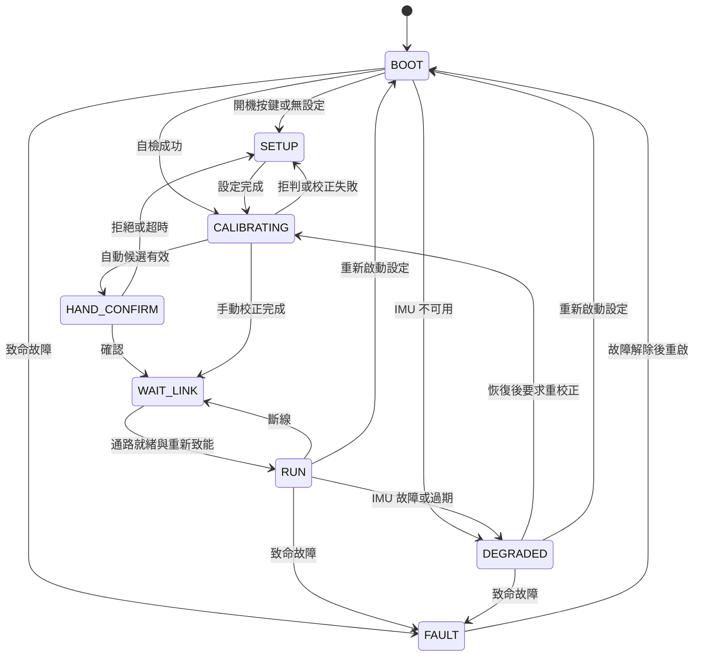
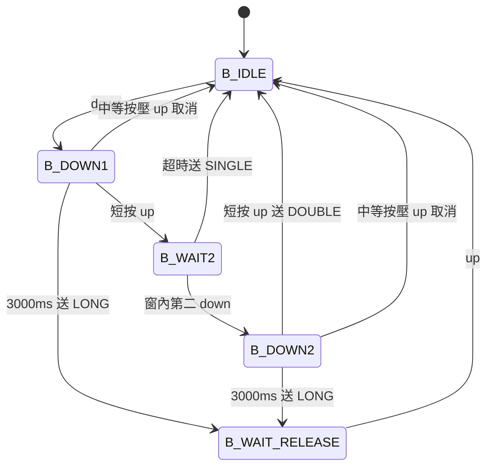
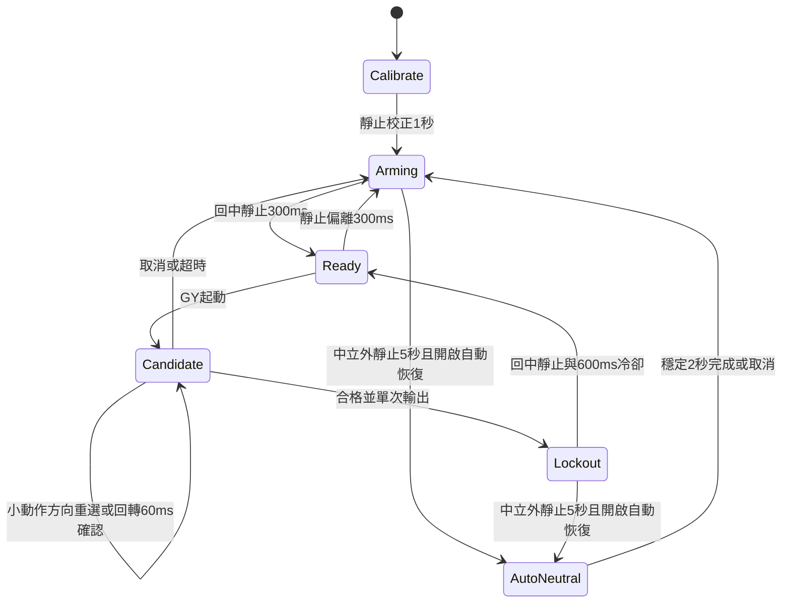
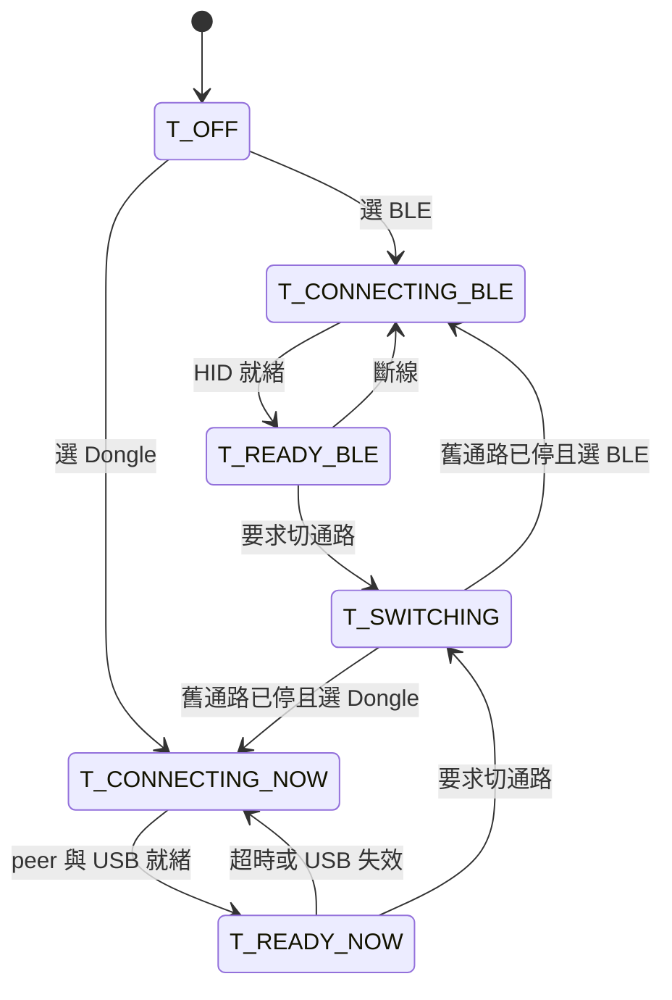

# 慧演 HuiYan｜產品需求文件（PRD）

文件版本：v1.1／Prototype 實作與實測對照版
更新日期：2026-11-17（Asia/Taipei）
文件狀態：現行Prototype需求／實作／有限實測對照，兼保留未來規劃；未代表產品完成或正式驗收通過。
適用範圍：ESP32-C3 Prototype，以及 XIAO ESP32S3＋ESP32-S2 Mini Dongle 未來版。

## 1. 文件依據、證據分級與現況

本次更新依據為目前 `src/main.cpp`、`Gesture.*`、`PairButton.*`、`TiltMouse.*`、`platformio.ini`、`README.md`、`data/` 舊資料及本次開發對話中的實測紀錄。README 負責接線與操作導引；本 PRD 記錄需求、變更原因、實作落差與驗收規劃。文件版號 v1.1 不等於韌體版號；目前 BLE 名稱仍為 `HuiYan V0.4`。

使用者已確認「實測與預估不符時採實測調整」，以及左旋下一頁的操作語意。實測只能支持觀察範圍內的結論，不能以放寬門檻或編譯成功當成可靠度驗收通過。變更彙整日為 2026-11-17；原始操作與訊息未逐項提供日期，不將彙整日冒充每次測試日期。

| 標記 | 定義 | 證據邊界 |
|---|---|---|
| U | 使用者明確確認的需求／操作 | 已決定，不代表實機驗收 |
| H | 舊對話的成果回述 | 歷史參考，需補原件 |
| P | 規劃／工程調校初值／驗收目標 | 尚未證明達標 |
| C | 目前原始碼可核對的實作 | 不代表硬體與主機行為正確 |
| B | 實際編譯成功紀錄 | 只能證明該建置組合可建置 |
| L | 使用者確認或可讀的局部實測紀錄 | 只限該次條件，非完整驗收 |
| V | 按凍結測試方法、版本與完整紀錄完成驗收 | 本次沒有任何完整 Gate 可標為 V 通過 |

### 1.1 證據索引

| ID | 來源 | 可支持的結論 |
|---|---|---|
| E-CODE | 本次核對的 `src/` 與 `platformio.ini`；更新前 Git HEAD `6934611`（Added README.md） | 現行實作與依賴；未重跑韌體測試，不將此 HEAD 指派給更早的實測韌體 |
| E-BUILD | 傾角滑鼠整合版本的成功建置紀錄 | Espressif32 8.0.0／Arduino-ESP32 3.3.12／NimBLE 2.5.2 可編譯，當次 RAM 25880 bytes、Flash 828437 bytes；非實機驗收 |
| E-LINK | 使用者回覆「hid 成功連接」 | 該次 BLE HID 連線成功；主機 OS build、應用與轉接器版本未完整提供 |
| E-BUTTON | 使用者回覆 GPIO6 診斷「有了」 | 配對鍵輸入有反應；不是完整配對與時序驗收 |
| E-FAIL | 多次串列紀錄，含 `b11488fe-bb4a-4cc2-aabb-02d04c28d408` 附件 | 舊 70° 上限、10° 回正及立即反向取消不適合此次自然動作；見 §19 |
| E-ROTATE | 附件 `adb0a484-4c9a-4b84-8b86-c8cf8a57c42d/貼り付けたテキスト.txt`（本機 Codex 附件識別） | NEXT／PREVIOUS 各一個，回轉期間無額外事件；詳見 §1.2 |
| E-DATA | `data/left.txt`、`data/right.txt` | 舊資料實際存在：左旋5段253筆、右旋6段344筆，不能當作左右手標籤 |

附件識別用於尋回對話證據，附件未隨專案版本控管；發布正式測試報告前須另將原始紀錄、韌體雜湊、主機設定及操作標籤歸檔。串列紀錄的 `t` 為開機毫秒，不是日期時間。原始 PRD 的對話來源保留於 §18，不再以舊助理回述推論現有成果。

### 1.2 有限範圍已觀察結果與待驗證功能

| 功能 | 目前證據 | 尚缺內容 |
|---|---|---|
| BLE HID | C＋B＋E-LINK | 配對／清除／重連矩陣、主機應用與長時測試 |
| GPIO6 配對鍵 | C＋B＋E-BUTTON | 2秒邊界、開機按住、窗口與連線中抑制的完整實測 |
| 旋轉及回轉防重複 | C＋B＋E-ROTATE | 主機畫面與輸入紀錄、多人／換戴／負樣本、延遲、成功率 |
| GPIO3 單／雙／長按 | C＋B；雙擊上一頁已 U 確認 | 最新按鍵配置、左右鍵與邊界實測；不沿用更早配置的結果 |
| 自動中立恢復 | C＋B | 5秒等待、2秒穩定、移動取消、切換開關及恢復無誤事件 |
| 傾斜游標 | C＋B | 目前尚未收到該功能的實機測試結果；方向、停止、漂移與點擊抑制均待驗 |
| CSV 採集 | C＋B＋舊資料 | 最新整合版採集回歸與單位／資料健康驗證 |
| 手別設定／自動辨識、設定選單、ESP-NOW、S2 USB、電池與獨立回饋 | P，尚未實作 | 保留未來規劃，不宣稱支援 |

E-ROTATE 的可核對事件如下：

| 開機時間 | 候選結果 | 去程量／主軸占比 | 輸出及後續 |
|---|---|---|---|
| 109672ms | `ACCEPT`，`return_ms=60`，direction=+1 | 58.0°／0.94，方向一致性1.00 | `GST EVENT NEXT hid_release_busy=0`、`GESTURE NEXT` 各一次；110593ms回到READY |
| 112334ms | `ACCEPT`，`return_ms=60`，direction=-1 | 96.9°／0.78，方向一致性1.00 | `GST EVENT PREVIOUS hid_release_busy=0`、`GESTURE PREVIOUS` 各一次；113394ms回到READY |

該段回轉與 LOCKOUT 沒有額外事件，可確認該組韌體的局部去重行為；`GESTURE` 代表 HID 成功排入傳送，不等於作業系統與簡報畫面已完成操作。觀察樣本只有兩次，不能推出95%成功率、自然演講零誤觸或全新整合版已回歸。使用者另確認左旋＝下一頁；六軸正負對應受佩戴方式影響。

## 2. 產品定位、價值與範圍

**產品定位：讓講者不必手持翻頁器，就能以穿戴裝置切換簡報與游標操作的互動控制器。**

核心價值是穩定翻頁、按鍵備援與必要時的游標點擊；正式演講中避免誤翻頁的優先度高於增加手勢數量。側置操縱桿滑鼠屬簡報現場的短時游標控制，不以精密繪圖、遊戲或全天候取代桌面滑鼠為目標。

| 優先度 | 內容 | 版本 |
|---|---|---|
| P0 | BLE HID 鍵盤＋滑鼠通路、單／雙／長按仲裁、可靠的簡報翻頁與按鍵備援 | Prototype |
| P0 | 固定佩戴座標、手動左右手設定、中立校正、失效時禁止異常輸出 | Prototype |
| P0 | 側置操縱桿速度控制、回正停止、左右鍵、模式可辨識 | Prototype |
| P1 | 有條件的左右手自動辨識、拒判及校正備援 | Prototype 研究；不得阻塞其他 P0 |
| P1 | XIAO S3 移植、ESP-NOW＋S2 USB HID、LiPo 與穿戴機構 | 未來版 |
| P2 | TinyML、額外震動回饋、更多手勢、多主機管理 | 驗證有需求後另立規格 |

非本版範圍：黑屏快捷鍵、拖曳、滾輪、三擊快捷鍵、雲端帳號、自動更新、同時控制兩台電腦。原較早對話曾提黑屏，但此次重新規劃未指定，不自動帶入。

## 3. 使用者與使用情境

| 使用者／場景 | 工作與操作 | 成功條件／失敗備援 |
|---|---|---|
| 教師、講師／教室 | 走動授課、左右快速翻腕上下頁 | 正常講解不誤翻頁；手勢失效時按鍵仍可用 |
| 商務簡報者／自己的筆電 | BLE 配對後直接簡報 | 開機後辨識連線與模式；不需 Dongle |
| 演講者／借用電腦 | 插入已配對 S2 Dongle，以 ESP-NOW 控制 | 標準 USB HID 可被該主機接受；無需專用應用程式，但受組織 USB 政策限制 |
| 展示者／網頁或互動簡報 | 長按切入滑鼠，傾斜移動、單擊選取、雙擊右鍵 | 能停止與精確點擊；回簡報不產生殘留操作 |
| 左／右手使用者 | 換手或重新佩戴後校正 | 相同語意的動作得到相同指令；不可偷偷反轉方向 |
| 拿麥克風、喝水或轉身時 | 自然動作、暫停操作 | 可暫停手勢；無意動作不構成翻頁 |

### 3.1 現行 C3 Prototype 流程（C，驗證範圍見 §1）

1. 固定目前已測佩戴方向，USB 供電，開機預設簡報／BLE；現階段沒有通路或手別設定選單。
2. 未連線、非採集時，GPIO6 長按2秒或串列 `p` 開啟60秒配對窗口；主機選 `HuiYan V0.4`。保存過 bonding 時可廣播重連。
3. HID ready 後放開按鍵；以自然中立姿勢輸入 `n`。靜止校正至少1秒且樣本≥40筆，再靜止300ms，看到 `READY` 才旋轉。GPIO3 按鍵備援不要求手勢校正成功。
4. GPIO3 單擊下一頁、雙擊上一頁；左旋下一頁、右旋上一頁。每次手勢後等回正與重新致能，不在 LOCKOUT 期間發動新指令。
5. GPIO3 長按3秒切至滑鼠，放開並完成約1秒中立取樣後才移動。再次長按返回簡報。
6. `n` 手動重定中立；`a` 切換簡報自動中立恢復；`g` 暫停手勢；`r` 進資料採集。完整指令見 §6.3 與 README。

未來仍需手動手別、條件式自動辨識與 BLE／Dongle 設定流程；目前不把這些未實作項目列為可操作步驟。

## 4. 硬體架構與電源

### 4.1 BOM 與責任分工

| 元件 | 目前 Prototype（U） | 未來版（U） | 工程要求 |
|---|---|---|---|
| 穿戴 MCU | ESP32-C3 Super Mini ×1 | XIAO ESP32S3 ×1 | 執行採樣、濾波、FSM、事件仲裁與通訊 |
| IMU | MPU-6050 ×1 | MPU-6050 ×1 | I²C 六軸資料；機構固定方向與座標版本化 |
| 按鍵 | GPIO3 微捏操作鍵＋GPIO6 配對鍵，共2顆常開瞬時鍵（C／U） | 操作鍵與配對／設定入口待硬體定版 | 皆內部上拉、低有效；不使用 BOOT 鍵替代操作鍵 |
| 接收器 | 無 | ESP32-S2 Mini ×1 | ESP-NOW 接收，USB 複合鍵盤＋滑鼠 HID |
| 電源 | USB 供電驗證（P） | 單節 3.7V LiPo | 穿戴端電池；Dongle 由主機 USB 供電 |
| 回饋 | 先核對板載 LED；不足時以 USB 診斷工具輔助 | 可辨識的狀態指示為必要需求 | LED 可視性／數量待查；震動元件未列原 BOM |

ESP32-C3 支援 BLE，可利用 HID 韌體實現鍵盤與滑鼠；實際 SDK／函式庫、描述符及主機相容性仍需驗證。[C3 資料表][S1]、[官方 BLE HID 範例][S2]。C3 的原生 USB Serial/JTAG 不等同可任意實作 USB HID Device，不將它規劃成 S2 的直接替代品。[USB 能力說明][S3]

S2 沒有 BLE 無線能力，因此未來 Dongle 路徑必須為 ESP-NOW → USB HID，不能畫成 BLE → S2。[S2 資料表][S4]。S2 支援 USB Device 的硬體條件不代表特定 Mini 板、USB 接頭與所選韌體已驗收；須確認 USB 資料線、腳位、枚舉與鍵鼠報告。[USB 能力說明][S3]

### 4.2 接線與整合要求

- 現行C3接線已依程式固定如下；仍需補實際板批、佩戴照片與I²C上拉電壓紀錄。S3／S2移植不得直接沿用。
- MPU-6050 的 SDA、SCL、電源、接地及可選 INT 需明確標示；確認模組是否有穩壓、I²C 上拉及其上拉電壓。邏輯介面以對 MCU 安全的 3.3V 為基準；不可僅因模組標註可接 5V 就假設匯流排也是安全的。
- 記錄感測器地址、WHO_AM_I、取樣率、量程、濾波器與軸向；上電檢查未通過不得啟用 IMU 操作。
- 按鍵採可控的上／下拉與去彈跳，避開會造成啟動模式異常的腳位。電源與無線峰值負載下需無異常重啟。
- 最終固定位置、束帶鬆緊及 PCB 軸向皆屬演算法輸入條件；任何機構變更均需重做映射與校正驗證。

#### 現行 Prototype 接線與建置設定

| 訊號 | 接點／設定 |
|---|---|
| MPU-6050 SDA／SCL | GPIO4／GPIO5，I²C 100kHz |
| IMU電源／GND | 依README為3V3／共地；實際模組與上拉電壓仍需確認 |
| 位址 | 依序嘗試0x68、0x69 |
| GPIO3／GPIO6 | 各經常開按鍵接GND，INPUT_PULLUP，去彈跳25ms |
| 配對鍵 | GPIO6外部JTAG功能需避讓；板上實體序號不是GPIO編號 |
| 開發設定 | `board=esp32-c3-devkitm-1`，實際為C3 Super Mini；不得視為板級完全等同 |
| USB／串列 | USB CDC診斷，115200 baud；目前USB供電測試，無電池驗收 |

### 4.3 電池與充電

XIAO ESP32S3 提供電池連接與充電相關功能，但應按實際板本的官方接法、電池極性及充電規格設計。[Seeed 官方說明][S5]。3.7V 為標稱值，一般單節 LiPo 的滿充電壓約 4.2V；不得將電池直接接入 3V3 腳。

未來版需核對：電池容量與保護、充電電流是否符合電芯、欠壓截止、短路保護、充電時帶載行為、USB 與電池切換、固定與防拉扯。低電量門檻須依電芯與電源路徑量測後決定，不以未校正 ADC 電壓直接宣稱剩餘百分比。

續航估算先用「可用容量 mAh ÷ 平均電流 mA」估算小時，再以含穩壓損失、LED、IMU、射頻與待機的完整樣機測試確認。電池容量、重量與實測電流目前未定，不能宣稱已達任一續航。

## 5. 軟體、座標與輸出架構

下圖為包含未來手別映射與Dongle的目標架構；現行C3僅BLE通路、固定佩戴映射，實作模組見§5.1。

資料路徑：IMU／按鍵 → 時戳與校正 → 裝置座標轉使用者座標 → 手勢／滑鼠運算 → 事件仲裁 → 單一有效通路 → HID 報告。



### 5.1 現行座標、採樣與單位（C）

- 目前固定佩戴映射為正GY＝左旋＝下一頁，負GY＝右旋＝上一頁（U確認語意、L局部紀錄）。不是左右手自動映射；換手／改裝需重測。
- 讀取週期20ms，約50Hz；±8g、±2000°/s、21Hz低通。舊100Hz、±4g、±1000°/s為v1.0初值，現階段保留實際硬體設定；如需提升取樣率，另量測負載後變更，不視為此版既定行為。
- I²C直接讀14 bytes並檢查結果；不以Adafruit `getEvent()`的回傳值作完整健康保證。
- CSV保留 m/s²、rad/s，`time_ms`為開機毫秒；手勢演算法與診斷換算成°/s、°。舊g、°/s輸出提案不套用現行CSV。
- 積分及游標位移使用實際Δt，樣本間隔或讀取過久>100ms時停止IMU輸出並重新校正；不補送缺樣／失聯位移。有限值、近零加速度及接近角速度量程上限另有檢查；故障注入仍待AC-01。
- `Gesture.*`處理翻頁與自動中立恢復，`TiltMouse.*`處理重力向量融合與速度控制，`PairButton.*`處理配對鍵，`main.cpp`負責輸入、採樣、HID與仲裁。完整手別／通路抽象與版本化設定仍待實作。
- IMU初始化失敗保留BLE按鍵備援，但目前沒有初始化失敗後的自動重新探測；重新啟動後再自檢。手勢門閘關閉時會清除候選與校正，因此操作按鍵後可能需重新靜止校正約1秒＋致能300ms，不能宣稱只等300ms。

## 6. 左右手自動辨識、局限與校正備援

### 6.1 能力邊界

MPU-6050 為三軸加速度計＋三軸陀螺儀，沒有磁力計。[MPU-6050 規格][S6]。六軸量測不能唯一識別左右手：兩手在不同佩戴／手腕姿態下可能給出相同重力與角速度。靜止重力能約束部分傾斜，不能提供不漂移的絕對航向；長時間積分陀螺儀也會累積偏移。

上述可觀測性限制是本 PRD 的工程推論；加入分類模型不能消除本來就重疊的資訊。自動辨識只在固定安裝、明定校正姿態與已測試族群下作條件式推測，不能宣稱任意佩戴皆能辨識。

### 6.2 未來需求 HY-HAND（尚未實作）

1. 「常駐」解釋為持續監看資料健康與校正有效性；**不在操作中持續改變左右手設定**。
2. 每次啟動／換手時，先採指定姿態：前臂自然向前、掌心向下、裝置標記朝指定方向，靜止至少 1 秒；照片與角度容許範圍須由機構定版。
3. 演算法輸出左／右／未知及信心值。未經標註驗證的信心分數不視為正確機率；門檻必須以保留測試資料決定。
4. 高信心時先顯示候選手別，使用者確認後鎖定至此次使用結束。低信心／佩戴不符時拒判，進入手動選擇，不能默默猜測。
5. 使用者可手動指定左／右；此路徑不依賴自動分類成功，可繼續驗證完整產品功能。
6. 運作期間異常姿態或機構疑似滑動時提示重新校正；無法只靠 IMU 保證偵測所有滑移。換手、重戴或裝置移位時，由使用者主動重新校正。
7. 保存的手別只作下次設定初值，仍須確認；中立姿態每次重新取樣。自動辨識無法達標時，第一版以手動左右手設定出貨，移除全自動宣稱。

### 6.3 現行設定入口與串列指令（C）

目前沒有SETUP／HAND_CONFIRM選單或手別保存。GPIO6長按2秒專用配對，GPIO3長按3秒專用模式切換；操作與配對分離。串列115200 baud，指令均為單一小寫字元。

| 指令 | 現行行為 |
|---|---|
| `p` | 未連線、非採集時開60秒配對窗口；已連線不強制斷線 |
| `c` | 未連線、非採集時清裝置bonding；主機亦須移除舊配對 |
| `n` | 非採集時清掉候選並重新校正目前模式中立；不得在校正完成前輸出IMU操作 |
| `a` | 切換簡報自動中立恢復，預設ON；非採集時接受，重開機不保存開關 |
| `g` | 切換手勢啟用／暫停，預設ON；不關閉傾角滑鼠 |
| `v` | 手勢／滑鼠診斷開關，預設ON；不改變辨識功能 |
| `r` | 採集開關；放開GPIO3後再按住錄製；停用操作HID及手勢／滑鼠診斷，保留CSV與片段標記 |
| `u`／`d` | 就緒簡報模式測試上一頁／下一頁 |
| `h`／`j`／`k`／`l` | 就緒滑鼠模式測試左／下／上／右相對位移 |

g、v、a的切換請依回覆判斷，不連續盲按。採集與操作互斥；換模式、斷線、重校正均不保留未完成指令。

### 6.4 未來設定與回饋規劃（P）

保留開機設定選單、手動左右手、條件式自動候選與拒判、通路選擇與保存的研究方向，但不得宣稱目前已支援。原單鍵開機3秒SETUP提案需依新增GPIO6重新審查，不占用既定模式長按事件。Prototype可先依串列顯示；正式版需可獨立辨識模式、連線、校正、手別、低電與故障。LED／震動與BOM仍列D-04。重新校正不再要求重啟：現行採 `n` 與 §8.2 的受限自動恢復。

## 7. 操作規格與按鍵仲裁

### 7.1 已確認操作表（U；實作C、實測邊界見§1）

| 模式／按鍵 | 動作 | 主機事件 | 狀態 |
|---|---|---|---|
| 簡報 | 目前佩戴下左旋（正GY） | Page Down／下一頁 | E-ROTATE局部紀錄＋U語意確認 |
| 簡報 | 目前佩戴下右旋（負GY） | Page Up／上一頁 | E-ROTATE局部紀錄＋U語意確認 |
| 簡報／GPIO3 | 單擊 | 下一頁一次 | C＋B，按鍵正式測試待補 |
| 簡報／GPIO3 | 雙擊 | 上一頁一次 | U確認，D-01已結案；C＋B，待實測 |
| 滑鼠 | 傾斜／回中 | 相對游標速度／停止 | C＋B，待實測 |
| 滑鼠／GPIO3 | 單擊／雙擊 | 左鍵／右鍵完整點擊一次 | 不是兩次左鍵；C＋B，待實測 |
| 任一操作模式／GPIO3 | 長按滿3秒 | 切換簡報／滑鼠一次，等待放開 | C＋B；滑鼠需中立取樣 |
| 未連線、非採集／GPIO6 | 長按滿2秒 | 60秒BLE配對窗口，非主機HID事件 | C＋B；輸入有反應已L確認 |

單擊等雙擊窗結束後才輸出，雙擊不先送單擊。主機應用需保持焦點；Page Up／Down的應用行為與完整釋放測試待驗。D-01由使用者明確指定「pin3雙擊上一頁」關閉，不再保留NEXT為現行雙擊預設；舊NEXT／PREVIOUS／NONE可設定方案僅為歷史提案。

### 7.2 現行按鍵時間參數（C；仍待AC-02／03驗收）

| 參數 | 初值 | 定義 |
|---|---|---|
| 去彈跳 | 25ms | 電位持續穩定後才接受 down／up，事件時間取確認時刻 |
| 雙擊窗 | 300ms；驗收另測250–350ms邊界 | 第一次有效 up 到第二次有效 down 的最長間隔 |
| 短按最長時間 | 500ms | down 至 up 不超過此值才可構成點擊 |
| 長按門檻 | 3000ms | 從有效 down 起算；滿門檻當下觸發，不等放開 |
| 過長但未滿長按 | >500ms 且 <3000ms | 放開僅取消，不產生單／雙擊 |
| 點擊抑制移動 | down 起至解析結束後 100ms | 滑鼠暫停位移，期間不累積待補位移；依人因結果調整 |

單擊必須等雙擊窗結束才送出，因此有約 300ms 固有延遲。不能先送左鍵再試圖撤回成右鍵。長按的優先權高於任何待決點擊；第一短按後，若第二按持續滿 3 秒，取消第一短按並只切換模式。第二按雖在雙擊窗內開始，若持續超過 500ms 且未滿 3 秒就放開，兩次皆取消，以避免不明確操作造成誤指令。

同一 tick 同時出現 up 與滿 3000ms，先判長按。第二 down 恰在 300ms 邊界可算雙擊候選；超過後視為新序列。三次快速短按解讀為一次雙擊加一個新的單擊候選，不另設三擊命令。

### 7.3 事件優先權與互斥

1. 致命電源／系統故障、設定與斷線閘門優先於所有輸出；IMU 故障優先停 IMU，但可保留已連線的按鍵備援。
2. 長按切模式時清除點擊、手勢候選、冷卻與位移；盡力釋放主機鍵鼠並等待按鍵放開。
3. 任何有效按鍵 down 起暫停手勢辨識，整段按鍵序列完成／取消後，現行會重新取得中立至少1秒，再靜止300ms才重新致能；避免按鍵操作帶動手腕又翻一頁。
4. 簡報手勢與滑鼠控制永遠不在同一操作模式並行輸出；BLE 與 ESP-NOW 永遠只有一個有效輸出通路。
5. 斷線期間不排隊操作；重連後不補送舊翻頁或游標資料。

## 8. 現行簡報手勢規格（C，實測調校；非全面驗收）

### 8.1 有限窗辨識與回轉防重複

流程為 `Calibrate → Arming → Ready → Candidate → Lockout → Ready`；不得以瞬間過門檻直接翻頁。固定映射見§7，未實作左右手辨識。

| 參數 | 現值 | 證據／原因 |
|---|---|---|
| 起動 | 校正後GY絕對值≥120°/s | 保留初值，靜止資料低於此值；泛化仍待驗 |
| 候選窗 | 起動起算500ms；修正方向、低速與回轉確認都不延長期限 | 限制舊事件存活時間 |
| 去程量 | 20～150° | 舊70°常在自然去程72～96°前後取消；150°為放寬後調校上限，不是實測最佳值 |
| 有效去程時間 | 同方向phase起算至少80ms | 前置小動作重新選方向後重新計phase，不重置500ms總窗 |
| 一致性／能量 | 有效方向角量÷總絕對角量≥0.8；GY能量÷三軸能量≥0.65 | E-ROTATE兩次為1.00及0.94／0.78；仍需負樣本驗證 |
| 結束路徑A | GY絕對值<40°/s連續60ms，且合格 | 單筆低速會過早終止前置動作；速度回升清除低速計時 |
| 結束路徑B | 去程先合格，凍結其方向／角量／能量；相反方向>40°/s連續60ms | 自然動作未必在極點停60ms；實測58.0°及96.9°皆由此路徑接受 |
| 回正 | 距校正重力方向≤25° | 原10°常因回正偏13～24°持續ARMING；非自動改變手別 |
| 重新致能 | 角速度向量<15°/s、加速度約0.9～1.1g、回正，持續300ms；成功事件後另距輸出≥600ms | 保留LOCKOUT避免回轉被再辨識 |
| READY中立失效 | 靜止且在25°外連續300ms才退ARMING | 避免原單筆10°邊界波動撤銷READY；移動／回中清除偏離計時 |

候選小於20°時保持觀察；若反向出現，須達到原120°/s起動門檻才重新選方向並清去程量，總候選期限不變。已達20°卻未符合去程品質的反轉取消；合格後反向60ms確認被中斷也取消，不猜測輸出。超過150°、超時、飽和或資料異常取消並回Arming／重新校正。

合格只回傳一次原去程方向；回轉只作確認，不另算新指令。成功後固定進Lockout，完成回正、靜止與冷卻後才能再觸發。局部無重複結果不能代替AC-04／05／17。擴大門檻或方向重選可能增加自然動作誤觸，須以負樣本重測；不達標可 `g` 關閉手勢，以按鍵操作。

### 8.2 自動中立恢復（U＋C＋B，尚未實機驗證）

預設ON，以 `a` 切換且不跨重啟保存。僅簡報手勢輸出閘門允許、處於Arming或Lockout時適用，不作用於Candidate、滑鼠、採集、配對窗口或斷線。

1. 連續符合靜止但在舊25°中立範圍外達5秒；開始取樣還需校正後角速度向量<8°/s。
2. 再累積2秒、至少80筆穩定資料：角速度向量<8°/s、加速度約0.9～1.1g、相對取樣起始重力方向漂移≤3°、累計角速度路徑≤8°。
3. 移動、回到舊中立、姿態超限或門閘失效即取消；不套用未完成的取樣，待下一次條件重新成立。取消判定有上述噪聲容許度，不宣稱偵測任何微小移動。
4. 完成後以穩定窗平均值更新當次中立及陀螺偏移，清除候選、積分、位移相關的手勢狀態；返回Arming，再靜止300ms才Ready。整段不產生翻頁、不補送舊事件。

手動 `n` 保留；開關變更會取消正在取樣的自動恢復。診斷為 `AUTO_CALIBRATE_BEGIN/CANCEL/COMPLETE`、`auto_restore`與`auto_stable_ms`。長時間穩定偏轉姿勢可能成為新中立，IMU無法判斷使用者意圖；必須測誤校正與恢復後誤觸，不能由編譯通過推論可用。

## 9. 滑鼠：側置操縱桿速度模式

### 9.1 現行控制模型（C＋B，實機待驗）

選用相對重力可觀測的兩個傾斜自由度：左右傾斜控制 X，前後傾斜控制 Y。保持傾斜會持續移動，回中立即停止；不以繞重力軸的絕對航向作長期控制基準，也不採雙重積分估算手的空間位置。

進入滑鼠時先釋放按鍵，再保持中立至少 1 秒取樣；校正完成前沒有位移。非靜止時延長等待，5 秒內無法取得有效中立則停在校正提示，不使用舊值強制啟動。

每軸相對角度 θ 的初始曲線：

```text
e = max(0, abs(θ) - 4°)
v = sign(θ) × 800 × min(e / (25° - 4°), 1)^1.5  HID counts/秒
當 abs(θ) <= 3° 時回到停止；再次超過 4° 才啟動。
每幀相對位移 = v × Δt，保留小數餘數，不累積被抑制的位移。
```

最大速度 800 HID counts/s、停止／啟動遲滯 3°／4°、25° 滿速及曲線指數 1.5 都是調校初值。HID 輸出是相對計數；像素效果受 OS 游標速度、縮放與加速影響，必須固定主機設定後校準計數對像素的換算。報告超範圍時分段或限幅，避免整數溢位。

目前 `TiltMouse.*` 使用陀螺儀推進重力向量，在加速度約0.85～1.15g時以時間常數0.15s修正。中立取樣至少1秒／40筆、角速度<15°/s、加速度約0.9～1.1g，且姿態相對取樣起點偏差≤3°；動態期間清空校正累計。基底由裝置X投影到中立切平面建立，退化時改用Y，另一軸由叉積建立；換戴方向仍待實測，並非通用左右手映射。

速度單位明確採HID counts/s，OS像素效果另測。每軸保留小數餘數，單包限幅-127～127；GPIO3／GPIO6按壓、待決點擊與待釋放報告期間，以及結束後100ms，清位移餘數、不補送抑制距離。斷線、切模式、採集、超時／讀取失敗或傳送失敗時停止並重置；不重送舊位移。相對中立重力偏離約60°以上會停止並重新取樣，穩定新姿態可重新校正，尚待人因驗證。這是異常姿態復原，正常持續傾斜不會自動重設中立。

### 9.2 行為要求

- 左右手均需完成方向校正；不能因換手導致上下／左右反轉。
- 中立區內輸出零位移，不以不斷自動重設中立掩蓋傾斜控制；否則持續傾斜會自行停止。
- 點擊時套用移動抑制，結束後重新以當前姿態計速，不補送抑制期間距離。
- 按鍵實體長按只用來切模式，不送滑鼠持續按住；本版無拖曳、無左鍵雙擊捷徑。
- 模式切換、斷線、校正、感測過期時停止游標並釋放滑鼠鍵；接收器也需有獨立 watchdog。
- 現行以串列 `n` 重定中立；若疲勞測試顯示需要即時暫停／離合器，列為下一次輸入設計的必要改版，避免臨時新增衝突手勢。

## 10. 狀態機設計：現行實作與未來目標

**範圍標示：§10.1／10.2與10.5為完整產品目標（P），包含尚未實作的SETUP、HAND_CONFIRM、FAULT與雙模通路；不能當作目前C3都有這些狀態。現行使用main內的ready／mouseMode／waitRelease等旗標、Button列舉與兩個獨立模組，實作映射及差距以本節和§5／§8／§9為準。**

目標採分層＋正交狀態機，避免把「手別、通路、模式、按鍵」混成單一龐大狀態。系統狀態為 `生命週期 × 通路 × 操作模式 × 按鍵解析 × 手勢狀態`，由本節的閘門與優先權限制合法組合。

### 10.1 全域規則

- 每輪先處理故障／斷線，再處理長按、按鍵、模式，再處理 IMU；同一事件最多被消耗一次。
- 未列出的輸入預設維持狀態且不輸出；不是自動跳回簡報。計時器使用單調時鐘並能處理溢位。
- `CLEAR`：清掉候選、點擊與相對位移，能傳送時送全鍵釋放；不能傳送時標記新連線第一包先釋放。Dongle 超時也本地釋放。
- 輸出閘門：僅 `RUN` 或按鍵備援的 `DEGRADED`，且通路 `READY`、不在等待放開／設定／校正時才可輸出。IMU 另需健康、手別映射有效且中立校正有效。
- 模式預設簡報；不從非揮發記憶體恢復成滑鼠。通路與使用者手別可保存，但不得保存未解析按鍵或手勢。
- BOOT 在上電按鍵入口判定結束前不啟用操作，避免尚在等 3 秒時已送出點擊。所有「等待放開」完成後，原本那次按壓必須已被消耗。
- DEGRADED 內長按仍可切換簡報／滑鼠的按鍵語意，但不進入依賴 IMU 的 MOUSE_NEUTRAL；游標永遠停住，單／雙擊備援仍可使用。IMU 恢復需另行重校正才啟用位移。

### 10.2 生命週期、設定與校正 FSM

| 狀態 | 事件／條件 | 動作 | 下一狀態 |
|---|---|---|---|
| OFF | 供電／啟動 | 清狀態、載入有效設定、禁止 HID | BOOT |
| BOOT | 上電鍵持續滿 3 秒 | 進設定，等待放開 | SETUP |
| BOOT | 未要求設定，自檢成功且已有手別設定 | 啟動選定通路，開始中立校正 | CALIBRATING |
| BOOT | 無有效設定 | 要求手別／通路設定 | SETUP |
| BOOT | IMU 自檢失敗，系統與按鍵健康 | CLEAR，開啟選定通路，提示只用按鍵 | DEGRADED |
| BOOT／任意活動狀態 | 致命系統錯誤或供電低於可靠工作範圍 | CLEAR、停止無線／關機流程 | FAULT |
| SETUP | 鍵放開後單擊 | 輪替當前選項，不發 HID | SETUP |
| SETUP | 長按 3 秒 | 保存此項，等待放開後移到下一項；最後一項開始校正 | SETUP／CALIBRATING |
| SETUP | 30 秒無輸入 | 有舊設定則取消修改並校正；無則保持待設定 | CALIBRATING／SETUP |
| CALIBRATING | 手動手別有效且靜止 ≥1 秒 | 保存此次中立；凍結手別映射 | WAIT_LINK 或 RUN |
| CALIBRATING | 自動辨識高信心且姿態有效 | 顯示候選，等待確認 | HAND_CONFIRM |
| CALIBRATING | 自動辨識拒判／5 秒超時 | 顯示未知，改手動／重試 | SETUP |
| HAND_CONFIRM | 單擊確認 | 鎖定手別與中立；消耗按鍵，等放開 | WAIT_LINK 或 RUN |
| HAND_CONFIRM | 長按／拒絕／30 秒無確認 | 取消候選，不猜測 | SETUP |
| WAIT_LINK | 通路 READY | CLEAR、按鍵放開且靜止 300ms 後致能 | RUN |
| RUN | 操作模式長按事件 | CLEAR，切模式，等待放開；進滑鼠需重新中立校正 | RUN（輸出暫停） |
| RUN | 模式為滑鼠且等放開結束 | 啟動 1 秒滑鼠中立取樣；未完成前閘門關閉 | RUN（校正子狀態） |
| RUN | 通路斷線 | CLEAR，不排隊，保留操作模式但停止輸出 | WAIT_LINK |
| RUN | IMU 過期 >100ms／讀取故障 | CLEAR，停手勢與游標，保留按鍵語意 | DEGRADED |
| DEGRADED | 按鍵／連線健康 | 只允許按鍵與模式切換；提示 IMU 不可用 | DEGRADED |
| DEGRADED | 通路斷線／重連 | CLEAR，關閉／重新開啟按鍵輸出閘門 | DEGRADED |
| DEGRADED | IMU 恢復健康且使用者要求重校正 | 不立即恢復，重新校正 | CALIBRATING |
| WAIT_LINK／RUN／DEGRADED | 主動重新啟動進設定 | CLEAR；重新從開機設定 | BOOT |
| FAULT | 重啟且故障條件解除 | 重新自檢 | BOOT |
| 任意活動狀態 | 移除供電 | 不保存未完成動作；接收端自行超時釋放 | OFF |

若校正完成時連線已 READY，直接進 RUN；否則 WAIT_LINK。滑鼠模式中的中立校正為 RUN 的輸出暫停子狀態，成功後才恢復 IMU 閘門；5 秒失敗則停留提示並容許長按回簡報，不自動移動。



圖為主要路徑；全狀態致命故障、斷電與校正後直接 RUN 的條件以狀態表及全域規則為準。

### 10.3 按鍵 FSM

| 狀態 | 事件／條件 | 動作 | 下一狀態 |
|---|---|---|---|
| B_IDLE | 有效 down | 記錄 t_down，暫停手勢及游標 | B_DOWN1 |
| B_DOWN1 | up，持續 ≤500ms | 不輸出，開啟 300ms 雙擊窗 | B_WAIT2 |
| B_DOWN1 | up，500ms<持續<3000ms | 取消序列 | B_IDLE |
| B_DOWN1 | 持續 ≥3000ms | 產生 LONG 一次，清候選 | B_WAIT_RELEASE |
| B_WAIT2 | 第二 down，間隔 ≤300ms | 取消單擊計時，記錄第二次 down | B_DOWN2 |
| B_WAIT2 | 窗口逾時且沒有第二 down | 產生 SINGLE 一次 | B_IDLE |
| B_DOWN2 | up，第二次持續 ≤500ms | 產生 DOUBLE 一次，不產生 SINGLE | B_IDLE |
| B_DOWN2 | up，500ms<持續<3000ms | 取消整段，不補第一單擊 | B_IDLE |
| B_DOWN2 | 第二次按住 ≥3000ms | 產生 LONG 一次；取消第一短按 | B_WAIT_RELEASE |
| B_WAIT_RELEASE | 仍按住 | 不輸出、不重複長按 | B_WAIT_RELEASE |
| B_WAIT_RELEASE | 有效 up | 啟動重新致能／模式校正 | B_IDLE |
| 任意 B 狀態 | 設定、斷線、故障、外部 CLEAR | 不發點擊；若仍按住則先等放開 | B_WAIT_RELEASE 或 B_IDLE |

未來在 SETUP、HAND_CONFIRM 中規劃使用相同去彈跳與長按底層，但由設定狀態消耗事件，不送操作命令。離開設定或重連時按住的鍵不構成新長按；必須先放開。



### 10.4 現行模式與手勢狀態對照（C）

| 狀態／事件 | 現行行為 | 下一狀態 |
|---|---|---|
| 簡報，GPIO3 SINGLE／DOUBLE | NEXT／PREVIOUS各一次 | 簡報 |
| 任一模式，LONG | 釋放報告、停止候選與滑鼠，切模式，等待放開 | 新模式 |
| 滑鼠未校正 | 靜止1秒取得中立；未完成只提示且零位移 | 校正後滑鼠運作 |
| 滑鼠 SINGLE／DOUBLE | 左／右鍵各一次，套用移動抑制 | 滑鼠 |
| 手勢輸出閘門關閉 | Gesture reset；無輸出 | Calibrate待重新允許 |
| Calibrate，靜止≥1秒且≥40筆 | 求中立及陀螺偏移 | Arming |
| Arming／Lockout，符合回正與靜止300ms | 清舊候選；Lockout另需輸出後600ms | Ready |
| Ready，GY達起動門檻 | 開500ms窗，保存方向 | Candidate |
| Ready，靜止但中立外連續300ms | 取消就緒，不默默改中立 | Arming |
| Candidate，小動作不足20° | 保留候選；合格反向起動可重選方向，不重置總期限 | Candidate |
| Candidate，去程合格＋低速連續60ms | 只送原方向一次 | Lockout |
| Candidate，去程合格後反向 | 凍結去程指標，反向>40°/s連續60ms才送原方向一次 | 確認中仍Candidate；成功後Lockout |
| Candidate，超時／超角度／品質不符／回轉確認中斷 | 不輸出；重新要求回正與靜止 | Arming |
| Arming／Lockout，自動恢復條件成立 | 5秒等待＋2秒穩定，期間零事件；移動／關閘取消 | 完成後Arming；取消則保留舊參考 |
| 感測異常／缺樣 | 無IMU輸出，reset並重新校正；按鍵語意可保留 | Calibrate／滑鼠未校正 |

按鍵實際列舉為 `Idle/Down1/Wait2/Down2`，另以 `waitRelease` 表達原設計的等待放開；§10.3為語意對照。已連線按鍵備援可在手勢或滑鼠未校正時使用；不把目標生命週期的全域校正閘門誤認為現行會禁用所有按鍵。



`AutoNeutral`是Arming／Lockout內的取樣子流程，並非程式新增同名列舉。模式、斷線、按鍵、配對及採集閘門會清除手勢狀態，圖未逐一展開；完整條件以§8及程式為準。

### 10.5 通路 FSM（與操作模式正交）

| 狀態 | 事件／條件 | 動作 | 下一狀態 |
|---|---|---|---|
| T_OFF | 載入有效 BLE 選擇 | 僅啟動 BLE 廣播／配對 | T_CONNECTING_BLE |
| T_OFF | 載入有效 Dongle 選擇 | 僅啟動指定 ESP-NOW peer／頻道 | T_CONNECTING_NOW |
| T_CONNECTING_BLE | 已連線、加密／配對與 HID 通知可用 | 先全釋放，不補舊事件 | T_READY_BLE |
| T_CONNECTING_NOW | 雙向 session 握手及 Dongle USB ready | 清序號視窗，確認活動 peer | T_READY_NOW |
| T_CONNECTING_* | 尚未連上 | 提示連線中，限制重試速率；不輸出 | 原狀態 |
| T_READY_BLE | BLE 斷線／HID 不可用 | CLEAR，關輸出閘門 | T_CONNECTING_BLE |
| T_READY_NOW | 心跳超時 500ms／USB 未就緒 | CLEAR；接收器本地釋放 | T_CONNECTING_NOW |
| 任意 T 狀態 | 設定要求改通路 | CLEAR、關閉舊通路、銷毀舊 session | T_SWITCHING |
| T_SWITCHING | 舊輸出已停 | 啟動選定新通路，不自動回退到另一台主機 | T_CONNECTING_BLE／NOW |
| 任意 T 狀態 | 系統關機／FAULT | 停止發送、能送則釋放 | T_OFF |

Runtime 不提供自動通路切換；從設定流程切換。D-03 若改成熱切換，仍必須先停舊通路並重新握手。



## 11. BLE 與 ESP-NOW 通訊需求

### 11.1 BLE HID 直連

Prototype 使用 C3 作 BLE HID peripheral；主機為 HID host。需同時有鍵盤翻頁與相對滑鼠報告，Report ID、按下／放開與訂閱行為皆明確；記錄所選 SDK 版本、HID 描述符與主機配對流程。[官方範例][S2]

保存 bonding 資料與提供清除配對的設定入口；清除配對不得在演講中意外觸發。初次配對只在使用者操作後允許，以避免連錯主機；配對窗口與識別方式列 D-03。斷線時所有輸出停止，重新連線先全釋放，再要求放開／靜止重新致能。主機顯示已連線不等於 HID 可用，需確認通知／報告通路。

#### 現行BLE建置與限制（C＋B）

平台`espressif32@8.0.0`、framework arduino、board `esp32-c3-devkitm-1`；本機成功建置Arduino-ESP32 3.3.12。依賴鎖定MPU6050 2.2.9、Unified Sensor 1.1.15、BusIO 1.17.4、NimBLE-Arduino 2.5.2。`pio run -e esp32-c3-devkitm-1`只編譯，不燒錄。

同一HID服務：Report ID 1鍵盤8 bytes、ID 2相對滑鼠3 bytes。就緒要求單主機連線、加密且鍵盤與滑鼠輸入報告都已訂閱；不是僅看藍牙已連線。通知失敗的位移丟棄，不補送；按下／釋放流程及斷線邊界仍待AC-13。

GPIO6／`p`開60秒窗口、`c`清bonding，不要求重啟進SETUP。Just Works bonding沒有MITM保護，未配對來源在窗口外拒絕；完整配對與主機隔離仍需實測，不宣稱高安全等級認證。

曾在NimBLE 2.3.6＋Arduino 3.3.12初始化崩潰，ELF雜湊`3267f0278…`對應呼叫鏈`NimBLEDevice::init → esp_bt_controller_init`。核對Arduino的BLE記憶體保留機制後升級2.5.2，後續使用者確認HID連線成功。這是該組合的修復紀錄，不代表所有主機及無線條件都已驗證。

### 11.2 ESP-NOW＋USB Dongle

未來穿戴端 XIAO S3 作事件產生端；S2 Mini 作指定接收器與 USB 複合 HID device。ESP-NOW 不需外部 AP，但雙方需相容的頻道與 peer 設定。官方說明指出發送 callback 成功不保證應用層已收到，可靠命令需自行設計 ACK、超時與序號。[ESP-NOW 文件][S7]

**協定初稿（P）：**

| 欄位 | 用途 |
|---|---|
| protocol_version、message_type、payload_length | 驗證相容性、類型與長度 |
| device_id、session_id | 綁定來源；每次重啟／重連建立新 session，排除舊封包 |
| sequence_id／event_id | 此 session 中單調遞增，重傳沿用原 ID |
| timestamp／有效期 | 有限壽命；時鐘未同步時以 session 與接收端 age 界線實作，不直接比較兩顆 MCU 絕對時鐘 |
| mode、command／mouse_delta、button_state | 明確動作與模式，拒絕非法組合 |
| ACK event_id、狀態／錯誤碼 | 確認事件被接收及處理，不冒稱應用畫面一定成功 |

離散翻頁／點擊：初始 ACK 等待 30ms、最多追加重傳 2 次、事件有效期 200ms；在同一 session 保留去重視窗至少 2 秒，重複封包只回 ACK 不再輸出 HID。下個事件使用新 ID。持續滑鼠位移：建議 50Hz，沿用序號去重，但不重送過期位移；超過 100ms 的位移丟棄，避免延遲後游標跳動。實際速率與參數必須以量測調整。

S2 每 100ms 心跳或等效資料健康檢查，500ms 無有效來源則停止游標、釋放所有鍵，退出 ready。USB 未枚舉／主機睡眠時不累積操作；恢復後重新握手並清空緩衝。封包 callbacks 只做短處理／入列，HID 與計算在工作任務執行。[ESP-NOW 文件][S7]

在重啟、掉電或 HID 已送出但 ACK 尚未送達的邊界，僅靠 RAM 去重不能保證跨 session 的「恰好一次」。規格選擇重啟後丟棄舊 session 與舊事件，不重播；可能漏掉一個指令，禁止為補償而重複翻頁。接收 ACK 代表軟體已處理，不代表 PowerPoint 一定消費了該按鍵。

指定 peer、受控配對及可用的 ESP-NOW 單播加密應納入產品版；MAC 篩選不是完整身分驗證。配對只在明確窗口內開啟，不在演講時接受任意控制來源。對多台同場裝置須驗證不交叉控制。

### 11.3 雙模原則

BLE 與 ESP-NOW 都在 2.4GHz 資源下工作。第一版採互斥通路，減少共存、耗電與重複控制；互斥不代表完全沒有外部 Wi-Fi／藍牙干擾。不宣稱 ESP-NOW 必然比 BLE 更快、省電或穩定，兩條路徑分別量測延遲、可靠度與電流。

## 12. 技術風險與緩解

| 風險 | 影響／優先度 | 緩解與驗證 | 未達標決策 |
|---|---|---|---|
| 左右手資訊重疊 | 方向反轉，高 | 指定姿態、固定機構、拒判、手動鎖定；保留人員測試 | 停止全自動宣稱，以手動為預設 |
| 無致能手勢誤觸 | 演講中跳頁，最高 | 完整時間窗、回正、冷卻、負樣本與長時自然演講測試 | 預設暫停手勢／另設致能版 |
| 回轉被辨識第二次 | 一次動作跳兩頁，高 | LOCKOUT 且回正後才重啟 | 不得進展示版 |
| 六軸航向漂移 | 游標持續偏移，高 | 使用重力傾角兩軸、中立校正、死區；不使用絕對 yaw | 調整控制模型與機構姿態 |
| 點擊擾動手腕 | 點錯目標，高 | 點擊時凍結位移、穩定按鍵位置，量測目標點擊 | 改按鍵／機構或速度曲線 |
| 單雙擊延遲與認知衝突 | 左鍵慢、右鍵誤觸，中高 | 延遲解析、不搶先送單擊，調窗並人因測試 | 檢討輸入方法，不隱藏延遲 |
| 輸入與設定混淆 | 模式／設定混淆，高 | GPIO3三秒切模式、GPIO6兩秒配對，Prototype以串列設定；未來獨立回饋待補 | 增加回饋／控制元件前先更新 BOM |
| BLE／主機差異 | 配對成功但不能操作，中高 | 固定版本矩陣、報告測試、重新配對流程 | 縮小支援範圍並標示 |
| ESP-NOW 丟包／重傳 | 漏頁／重複頁，高 | ACK、去重、session、期限與斷線測試 | 不接受無去重 Dongle |
| USB 重插／主機睡眠 | 黏鍵與延後補送，高 | 全釋放、watchdog、清 buffer、ready 握手 | 修復前不可產品化 |
| 穿戴滑移／手大小差異 | 映射失效、疲勞，高 | 固定方向、防滑與多手型測試；校正提示 | 調整機構，不靠模型硬補 |
| MPU 模組品質／供應 | 漂移或批次差異，中高 | 板批記錄、自檢、偏移與噪聲抽測，評估替代料 | 換料後重做資料與驗收 |
| 電池、無線峰值、充電熱 | 重啟／不可用，高 | 電源量測、保護與電芯匹配、帶載充電試驗 | 未有合格紀錄不開放穿戴充電使用 |
| 數據過擬合 | 實驗室好、現場差，高 | 依使用者分割資料，保留不同日／手別／環境 | 增採集或縮小使用條件 |

## 13. 可靠性、人因與可維護性

- **誤觸優先管理：** 同時報告漏判與誤判，不能只展示訓練資料準確率。自然演講負樣本需涵蓋指向螢幕、比手勢、拿麥克風、喝水、轉身與走動。
- **模式感知：** 使用者不看除錯視窗也應知道當前模式、是否連線及是否可操作；Prototype 可先工具顯示，未來版須獨立完成。切換回饋須在 3 秒門檻後立即出現。
- **疲勞：** 支援自然前臂姿態，不要求持續大角度扭腕；測試最大舒適角、30 分鐘疲勞與換手。若痛感或麻木出現，結束該次試驗並記錄，不用來追求測試時長。
- **失效退路：** IMU 故障時保留按鍵；無手別校正時禁止 IMU，提供設定入口；失聯時禁止排隊。產品不能以「自動辨識尚未成功」阻塞基本翻頁演示。
- **設定一致性：** 手別、軸向、門檻、速度曲線及通路協定需版本化；配置不相容時拒絕載入並提示，不以不明預設繼續。
- **韌體健全性：** 使用有界緩衝、watchdog 與事件日誌；量測 IMU 採樣與通訊是否互相阻塞；長時測試不得出現記憶體持續增加、漏釋放或重啟。
- **資料治理：** 採集檔需包含匿名受測者、左右手、佩戴照片／方向代碼、裝置／韌體版本、情境、時間戳、標籤與同意範圍；對外分享移除可識別資訊。

## 14. 量測方法與驗收準則

**以下全部是 P 級目標，尚未完成整項驗收。** 局部L證據僅列§1，不將AC-05等整項勾選通過。門檻變更後須重跑負樣本與受影響測項。 數值待需求審查後凍結；任何調整須記錄原因，不以放寬門檻偽裝通過。

### 14.1 共通測試條件

- Prototype 先以一台確定版本的 Windows 11 電腦、指定 PowerPoint 放映及指定 Chrome／Google Slides 測試；記錄 OS build、瀏覽器／應用版本、BLE adapter、距離、韌體與電池／USB 供電條件。這是驗證矩陣提案，不代表已支援。
- 其他 OS（macOS、Linux）、其他簡報軟體及組織管理電腦先列未驗證。未來版相同主機分別測 BLE／Dongle。
- 滑鼠測試固定 1920×1080、100% 縮放、固定游標速度並關閉加速；變更設定需另列結果，不直接混算像素數。
- 至少 5 名受測者，涵蓋左右手與不同手型；手勢每人每手每方向 50 次，共至少 1000 次。先用開發資料調參，驗收時參數凍結；若做分類模型，至少保留 2 名未參與調參者，另報其結果。
- 成功定義為主機收到正確、唯一且對應應用行為的事件；同一動作多送一次算失敗且列重複誤觸，不能以「有辨識到」算成功。保留 confusion matrix、漏判、反向、重複與誤輸出數。
- 時間量測用同一時基的韌體事件與主機輸入紀錄，或同步高速錄影；報告樣本數、p50、p95、最大值。分清識別／按鍵等待時間及通訊延遲，不能混算。

### 14.2 驗收表

| ID | 項目 | 測試方法 | 通過準則（提案） | Gate |
|---|---|---|---|---|
| AC-01 | IMU 採樣與資料健康 | 現行50Hz連續30分鐘（原100Hz提案已調整），記錄時間戳；注入 I²C 中斷 | 有效樣本 ≥99%；缺樣 >100ms 後 50ms 內停止 IMU 輸出；不產生突跳 | G1 |
| AC-02 | 按鍵單／雙擊 | 單、雙各 100 次，涵蓋兩操作模式與 250／300／350ms 邊界；另用可重現事件驗證極限 | 每類正確率 ≥99%；雙擊不得先送單擊；500–3000ms 中等按壓無點擊 | G1 |
| AC-03 | 長按與模式切換 | 每模式 50 次，含持續 10 秒、邊界放開、第二按長按 | 每次恰切一次；3 秒門檻處理誤差 ≤50ms；多餘鍵鼠事件 0 | G1 |
| AC-04 | 自然演講誤翻頁 | 每人每手 20 分鐘，含指定負樣本，共至少 200 分鐘 | 每段誤翻頁 0；任何一次即回開發，不以平均稀釋 | G2 |
| AC-05 | 有意手勢翻頁 | 共 ≥1000 次，分手別／方向報告 | 總正確率 ≥95%，每手每方向 ≥90%；回轉重複輸出 0 | G2 |
| AC-06 | 翻頁延遲 | 手勢物理結束至畫面變化 ≥100 次；按鍵另量 | 手勢 p95 ≤250ms；單擊從第一次 up 至畫面 p95 ≤450ms（含 300ms 窗） | G2 |
| AC-07 | 手別／拒判與備援 | 每人每手重新佩戴 30 次，共 300 次；另加 ≥50 次錯誤／含混姿態 | 有效姿態自動覆蓋率 ≥90%；已接受結果正確率 ≥98%；含混姿態至少 90% 拒判；操作中手別自動變更 0；手動設定 100% 可完成 | G3 |
| AC-08 | 滑鼠中立穩定 | 左右手各 10 次、每次 60 秒自然中立 | 每次游標淨偏移 ≤5px，且不出現持續單向移動超過 1 秒；另記手抖與最大偏移 | G3 |
| AC-09 | 滑鼠回正停止 | 每手每方向 20 次從傾斜回中立 | 回正至停止 p95 ≤150ms，停止後 1 秒額外位移 ≤5px | G3 |
| AC-10 | 點擊任務 | 每人每手 20 個 32×32px 目標、距離 200–600px；左／右鍵各測 | 命中率 ≥90%；到達目標時間中位數 ≤5 秒；按鍵操作到輸出期間位移 p95 ≤5px；右鍵不先出左鍵 | G3 |
| AC-11 | 模式辨識與疲勞 | 5 人每人 20 次隨機辨識模式；30 分鐘使用後 0–10 分主觀評分 | 模式判斷 ≥95%；疲勞中位數 ≤3、任一人 ≤5；記錄中止及原因 | G3 |
| AC-12 | 無線距離與延遲 | BLE／NOW 各於 1、5、10m 室內視距，安靜／忙碌 2.4GHz 環境，各條件 200 命令 | 命令唯一送達率 ≥99%，重複 0；決策後至主機輸入 p95 BLE ≤100ms、Dongle ≤80ms；記錄干擾條件 | G1／G4 |
| AC-13 | 斷線／重連 | 每通路 20 次關閉主機、離開範圍及恢復；測重連時按住按鍵 | 斷線不排隊、重連無補送；恢復條件可用起 p95 ≤10 秒恢復；Dongle 失聯 ≤500ms 全釋放 | G1／G4 |
| AC-14 | 協定去重與過期 | 注入 ≥1000 次重複／亂序／過期包、ACK 遺失與兩端重啟 | 重複 HID 0；舊 session／過期包執行 0；無黏鍵；重啟可漏事件但不得重播 | G4 |
| AC-15 | USB HID 與重插 | S2 插拔、主機睡眠／喚醒各 20 次；驗鍵盤、滑鼠報告 | 可正常枚舉並恢復，p95 ≤5 秒（主機 USB 可用後起算）；無舊輸出與黏鍵 | G4 |
| AC-16 | 雙模互斥與多機隔離 | 20 次通路切換；至少兩套同場互動 | 每次只有選定主機收到事件；未配對來源控制 0；切換不產生點擊 | G4 |
| AC-17 | 長時穩定 | 每操作模式／通路組合連續 2 小時 | 無重啟、無持續記憶體增長、無黏鍵、無無意模式切換；日誌完整 | G2／G4 |
| AC-18 | 未來版續航 | 凍結電芯與完整樣機；各通路分別 2 次：80% 簡報待命、10% 翻頁、10% 滑鼠 | 暫定每次 ≥4 小時；報容量、平均／峰值電流與截止原因；若目標不可行須正式修訂 | G4 |
| AC-19 | 供電／低電與充電 | 各電量區間無線負載、USB 插拔各 20 次，依電芯規範測充電 | 無異常重啟、極性與保護正確；低電有提示且截止前停止控制；所有電壓／電流／溫度皆在元件及電芯規範內 | G4 |
| AC-20 | 機構與重戴 | 每人每手重戴 10 次；含走動與麥克風情境 | 不鬆脫；校正可完成；完成後仍滿足方向與點擊要求；不適原因逐例記錄 | G3／G4 |
| AC-21 | 自動中立恢復 | 開／關各20次，含中立外5秒、穩定2秒及取樣中移動／按鍵／斷線 | 關閉不改中立；移動取消且不採用部分樣本；完成後清舊事件、靜止300ms才Ready；額外翻頁0 | G2 |
| AC-22 | 滑鼠抑制與感測故障 | 左／右鍵、模式切換、錄製、I²C錯誤與>100ms缺樣各20次 | 按鍵解析及後100ms不補位移；故障／重連重新校正，無延遲突跳，按鍵備援可用 | G1／G3 |
| AC-23 | 新手勢邊界與回轉 | 凍結150°／25°／500ms／60ms，測小前置動作、方向重選、正反轉、超限及READY邊界；逐樣本重播加實機 | 兩種確認路徑各只送一次；過期／超限不送；回轉無重複；靜止偏離連續300ms才撤Ready；完整保存紀錄 | G2 |

AC-04 的零誤觸僅表示指定測試窗未觀察到誤觸，不是永不誤觸保證。AC-07 若未達標但手動路徑達標，允許以手動手別版繼續，且明確移除自動辨識承諾。其餘 Gate 失敗須修正或經記錄縮小需求，不勾選通過。

### 14.3 測試紀錄模板

```text
測試 ID／日期／執行者：
硬體板型與批次／機構版本／電池：
韌體版本／配置雜湊／手別與座標版本：
主機 OS、應用、藍牙、USB 與游標設定：
通路／距離／干擾環境／供電：
受測者代碼／訓練或保留測試組／樣本數：
韌體雜湊／150°與25°配置／GPIO3雙擊上一頁／自動恢復開關／所有相關門檻：
原始資料、主機事件紀錄與錄影路徑：
成功／漏判／反向／重複／誤觸數：
p50／p95／最大延遲（註明起訖點）：
通過／失敗／限制／問題追蹤編號：
```

## 15. 開發階段與可勾選進度表

勾選規則：`[x]`只代表該項明列的證據範圍完成；標C／B的是實作／建置交付，標L的是局部觀察，標U的是需求決策，皆不等於V驗收。H僅為歷史回述。`[ ]`表示該項尚待完成或補證；下列Gate驗收項不因程式存在、局部成功或本文件更新而勾選。

### 15.0 已完成的限定交付與局部觀察（不等於Gate通過）

- [x] C／B：BLE複合鍵鼠、GPIO3單雙長按、GPIO6配對鍵及模組化程式可核對並成功建置。
- [x] L：使用者確認HID連線、GPIO6診斷輸入有反應。
- [x] L：E-ROTATE一組NEXT／PREVIOUS各一次，回轉無額外事件並回到Ready；僅該組紀錄。
- [x] C／B：自動中立恢復與傾角滑鼠已寫入並編譯；此勾選不含實機驗收。
- [ ] V：主機畫面確認、GPIO3邊界、自動恢復、滑鼠人因及完整可靠度均待補。

### 15.1 歷史基礎成果（H：完成回述，待補原件）

- [x] ESP32-C3 與 MPU-6050 的舊版基本硬體測試曾完成；依原助理回述，接線／版本／量測紀錄待補。
- [x] 微捏按鍵的舊版基本測試曾完成；不包含本版單擊／雙擊／3 秒長按仲裁驗收。
- [x] 左右旋轉感測資料曾採集，原對話提及 `left.txt`、`right(1).txt`；現已取得left.txt 253筆／5段、right.txt 344筆／6段；採集版本與佩戴標籤仍待補。
- [ ] 已取得現行程式與兩份舊資料；仍須補實際硬體、採集版本、完整測試條件與正式驗收證據，才可提升為V。
- [ ] 早期被提名的V0.4原件仍不能與現行同名BLE名稱混同；目前程式已取得並編譯，早期版本與完整實機追溯待補。

### 15.2 G0：規格與證據凍結

- [x] U：D-01已決定GPIO3雙擊上一頁；實機按鍵驗收仍見G1。
- [x] U：目前佩戴語意左旋下一頁、右旋上一頁已確認。
- [ ] 固定安裝照片、手動左右手配置與換戴映射仍待完成。
- [ ] 確認滑鼠採側置操縱桿速度控制、兩個可觀測傾斜軸。
- [ ] 驗證GPIO6配對／串列設定與清除方式；未來獨立設定介面及模式回饋仍待定。
- [ ] 凍結 Prototype 接線表、元件板型、SDK 與 HID 函式庫版本。
- [ ] 建立資料／測試紀錄與需求追蹤，確認所有提案目標。

完成條件：P0 規格無矛盾，所有待決有負責人與處置，歷史成果證據邊界清楚。

### 15.3 G1：C3 BLE 基礎可操作

- [ ] 新版 IMU 驅動、時戳、校正、資料健康與故障注入驗證。
- [ ] BLE HID 鍵盤可在指定主機實際上下頁。
- [ ] BLE HID 相對滑鼠與左右鍵可在指定主機實際操作。
- [ ] 按鍵去彈跳、單／雙擊延遲解析與長按 FSM 實機驗證。
- [ ] 模式切換只觸發一次、清除候選、等待放開及全鍵釋放。
- [ ] 完成配對、清除配對、斷線、重連與不補送測試。
- [ ] AC-01／02／03 與 BLE 部分 AC-12／13 達標並保存紀錄。

### 15.4 G2：簡報可靠度

- [ ] 將舊版 V0.4 思路移植或重寫為本版 FSM，確認新版規格差異。
- [ ] 手動手別尚未實作；中立校正已C／B及L局部觀察，換戴映射待驗。
- [ ] 採集多使用者、雙手、不同佩戴與自然演講負樣本。
- [x] C／B：候選、雙確認路徑、LOCKOUT、回正與冷卻已實作。
- [ ] AC-23新門檻、前置動作與回轉邊界完整實測。
- [ ] 驗證按鍵序列期間不會額外產生手勢翻頁。
- [ ] AC-04／05／06／17／21／23簡報相關測項達標。
- [ ] 誤觸未達標時，決定手勢預設暫停或另開致能版輸入設計。

### 15.5 G3：滑鼠、左右手研究與人因

- [ ] 滑鼠中立、速度曲線、死區與遲滯已C／B；實機驗證仍待完成。
- [ ] 單擊左鍵、雙擊右鍵不衝突；點擊位移抑制有效。
- [ ] 滑鼠回正停止、靜止漂移與點擊任務驗證。
- [ ] 自動手別資料標註、條件分析、信心與拒判機制。
- [ ] 若使用模型，完成依人員分割的保留測試，無資料洩漏。
- [ ] 自動手別失敗時，手動設定及重校正流程仍可完成。
- [ ] 完成模式可辨識、30 分鐘疲勞、手型與重戴測試。
- [ ] AC-07至AC-11、AC-20及AC-22原型部分完成；自動項未達標則正式縮減宣稱。

### 15.6 G4：未來版與雙模整合

- [ ] 移植 XIAO ESP32S3，重新確認接線、採樣、方向與 BLE HID。
- [ ] S2 Mini USB 複合鍵鼠 HID 實機驗證。
- [ ] ESP-NOW peer／頻道、配對、session、ACK、重傳與去重。
- [ ] 滑鼠位移期限、亂序處理、接收器心跳與釋放 watchdog。
- [ ] BLE／Dongle 互斥切換與多機隔離。
- [ ] LiPo、保護、充電、電源切換、低電提示與功耗實測。
- [ ] 裝置固定、防滑、天線位置與回饋元件定版。
- [ ] AC-12 至 AC-20 未來版全部適用測項完成並保存紀錄。
- [ ] 重新執行受移植／機構／供電影響的 G1–G3 測項，不沿用 C3 結果充數。

### 15.7 G5：展示版／產品化決策

- [ ] P0 需求均有對應通過紀錄，開放問題有明確處置。
- [ ] 建立快速入門、模式／手別／連線指示及失效備援說明。
- [ ] 在真實演講環境試用並收集誤觸、疲勞與設定困難。
- [ ] 凍結支援主機／軟體矩陣、已知限制、韌體與硬體版本。
- [ ] 若進入販售，再建立目標市場射頻、電池及其他適用合規要求的獨立計畫；本 PRD 未宣稱已取得認證。

各階段以 Gate 結果推進，不以預估日期當作完成證據；開發人力、工時及採購交期尚未提供，暫不捏造上市日。

## 16. 待決事項與變更控制

| ID | 待決內容 | 本文件建議／暫行處理 | 關閉時點 |
|---|---|---|---|
| D-01 | GPIO3簡報雙擊語意 | 已結案（U）：上一頁；單擊下一頁，不先送單擊。最新配置C／B，實機驗收待G1 | 2026-11-17彙整；決策來自本次對話 |
| D-02 | 翻腕方向、佩戴機構與映射 | 目前左旋下一頁已U確認；機構、左右手映射與換戴驗證仍開放 | G0；機構改版重開 |
| D-03 | 通路、配對與清除 | C3已採GPIO6／p配對、c清除；BLE僅連線成功有L證據。未來Dongle及持久設定選單仍P | G1／G4 |
| D-04 | 使用者可見回饋及元件 | Prototype 可診斷工具；未來版需獨立模式／連線／校正回饋，確認是否加 LED／震動及 BOM | G3 前 |
| D-05 | 自動手別能否成為產品承諾 | 先測可分性、覆蓋率與拒判；不達標改手動為預設 | G3 |
| D-06 | 無致能翻頁是否適合正式演講 | 以自然演講零誤觸測試為 Gate；失敗預設暫停 | G2 |
| D-07 | 電池容量、尺寸、重量、充電與續航目標 | 暫定 4 小時工程目標，待功耗與電芯規格凍結 | G4 前 |
| D-08 | 支援 OS／簡報軟體範圍 | 先驗 Windows 11 指定版本與指定應用；其他未驗證 | G1 前 |
| D-09 | 中立重設／離合器 | 現行n校正、a簡報自動恢復、滑鼠按鍵抑制已C／B；人因與自動恢復實測待補 | G2／G3 |
| D-10 | 歷史版本與證據歸檔 | 現行程式與舊資料已取得；早期版本、主機設定與原始實測附件需版本化歸檔 | G0–G1持續 |

每項變更紀錄：決策日期、負責人、舊／新規格、原因、影響需求／FSM／測項及需重跑的驗收。不得只改操作表而漏改 FSM 與測試。

## 17. 需求與驗收追蹤摘要

| 需求群 | 本文位置 | 驗收／交付證據 |
|---|---|---|
| HY-HW：Prototype／未來硬體 | §4 | 接線表、板型、AC-01／15／18／19 |
| HY-HAND：手別、限制與備援 | §6 | 校正資料、手別配置、AC-07／20 |
| HY-INPUT：單／雙／長按與模式 | §7、§10 | D-01 決策、AC-02／03／11 |
| HY-PRESENT：手勢與按鍵翻頁 | §8、§10 | 標註資料、AC-04／05／06 |
| HY-MOUSE：側置操縱桿與點擊 | §9 | 中立／速度參數、AC-08／09／10 |
| HY-LINK：BLE／NOW／USB | §11 | 報告描述符、協定、AC-12–16 |
| HY-REL：可靠性與人因 | §12–14 | 故障注入、長時紀錄、AC-11／17／20 |

### 17.1 本次新增追蹤

| 需求／變更 | 程式與文件 | 待驗收 |
|---|---|---|
| GPIO3雙擊上一頁（D-01） | main.cpp；§7／§19 CH-01 | AC-02／03 |
| 150°／25°、前置動作及回轉確認 | Gesture.cpp；§8／§10.4／§19 | AC-04／05／06／17／23 |
| 自動中立恢復 | Gesture.cpp；§8.2 | AC-21及AC-04負樣本 |
| 傾角滑鼠與位移抑制 | TiltMouse.cpp、main.cpp；§9 | AC-08／09／10／22 |
| 50Hz與SI採集 | main.cpp；§5.1 | AC-01與整合CSV回歸 |

## 18. 參考資料

外部技術資料原核對日期：2026-11-10；本次2026-11-17只核對本機程式、README與對話實測，未重新查核下列網站。官方文件用於確認元件能力與架構限制，不代表慧演實機已完成測試。SDK 文件或範例可能隨版本更新，實作時須鎖定實際使用版本。

- 原始需求及歷史回述：[〈慧演產品定位整理〉原對話](chatgpt-conversation://6ac638a4-bf04-83ee-802f-307c46e3ad8e)。讀取範圍涵蓋 S2 Dongle、BLE／ESP-NOW 比較、重新規劃與 PRD 請求；無附件。
- [S1：Espressif ESP32-C3 Datasheet][S1]：C3 BLE 與周邊能力。
- [S2：Espressif BLE HID Device 官方範例][S2]：支援目標及鍵鼠 HID 報告範例；需自行實測整合。
- [S3：Espressif USB Peripheral Introduction][S3]：C3 Serial/JTAG 與 S2／S3 USB 能力差異。
- [S4：Espressif ESP32-S2 Datasheet][S4]：S2 Wi-Fi、USB 能力與無 BLE 的架構條件。
- [S5：Seeed XIAO ESP32S3 Getting Started][S5]：板級電池連接／充電說明；以實際版本為準。
- [S6：TDK／InvenSense MPU-6000／MPU-6050 Product Specification][S6]：六軸感測器與介面基礎。
- [S7：Espressif ESP-NOW Programming Guide][S7]：頻道、peer、發送回呼與應用 ACK／序號建議；正式實作需選對 S3／S2 及 SDK 版本。

[S1]: https://documentation.espressif.com/esp32-c3_datasheet_en.html
[S2]: https://github.com/espressif/esp-idf/blob/master/examples/bluetooth/bluedroid/ble/ble_hid_device_demo/README.md
[S3]: https://docs.espressif.com/projects/esp-iot-solution/en/latest/usb/usb_overview/usb_overview.html
[S4]: https://www.espressif.com/sites/default/files/documentation/esp32-s2_datasheet_en.pdf
[S5]: https://wiki.seeedstudio.com/xiao_esp32s3_getting_started/
[S6]: https://product.tdk.com/system/files/dam/doc/product/sensor/mortion-inertial/imu/data_sheet/mpu-6000-datasheet1.pdf
[S7]: https://docs.espressif.com/projects/esp-idf/en/stable/esp32/api-reference/network/esp_now.html

## 19. 變更紀錄與下一輪驗證

以下為2026-11-17彙整的本次開發決策，逐項測試日期未完整提供。需求決策者為使用者；本次僅更新文件，沒有修改程式、重跑編譯、燒錄、commit或push。程式已成功建置的證據來自既有E-BUILD，不冒稱此次文件更新又執行了測試。

| ID | 舊規格／問題 | 現行決策與原因 | 狀態／需重測 |
|---|---|---|---|
| CH-01 | D-01雙擊下一頁／待決 | 使用者明確指定GPIO3雙擊上一頁，與單擊下一頁形成備援 | U＋C＋B；AC-02／03 |
| CH-02 | 助理原提案右旋下一頁 | 使用者確認左旋下一頁；固定佩戴下正GY送NEXT、負GY送PREVIOUS | U＋E-ROTATE；AC-05、換戴 |
| CH-03 | 20～70°及中立10° | 自然翻腕多在72～96°前後被上限提前取消、回正偏13～24°；改20～150°及25°，不是最佳值或全面驗收 | C＋B；E-ROTATE58.0°／96.9°兩次成功；AC-04／05／23 |
| CH-04 | 單筆低速就結束 | 曾60ms／6.4°小動作先結束而錯過後續主動作；低速需連續60ms，不足20°保留原500ms窗 | C＋B；需專測低速路徑，不以回轉路徑成功替代 |
| CH-05 | 方向一旦反轉就取消 | 101°去程、一致性97%仍因回轉被拒；新增合格去程凍結＋反向連續60ms確認，前置小動作可重選方向 | E-ROTATE兩次由回轉確認接受；AC-23與負樣本 |
| CH-06 | READY可在已離中立仍保持；後改單筆邊界就退出 | 紀錄有21～30°偏離仍READY，以及10.6°單筆波動漏下一手勢；改靜止偏離現行中立範圍連續300ms才撤Ready | C＋B；AC-23；參數跟隨25° |
| CH-07 | 超限後ARMING缺恢復指引；中立只能手動 | 補ARMING／LOCKOUT5秒未回正提示；使用者批准可開關自動恢復5秒＋2秒，保留n與取消機制 | C＋B；AC-21未驗 |
| CH-08 | 原單鍵設定／配對提案 | GPIO3操作、GPIO6獨立配對，長按2秒＋60秒窗口；目前用串列而非SETUP選單 | C＋B，輸入L；完整配對待G1 |
| CH-09 | 原100Hz／±4g／±1000°/s／g輸出預估 | 保留既有20ms／±8g／±2000°/s／21Hz與SI CSV，避免資料與硬體設定不一致；以checked burst read提高可診斷性 | C＋B；AC-01、採集回歸 |
| CH-10 | 舊NimBLE2.3.6可編譯但初始化崩潰 | 配合本機Arduino3.3.12記憶體保留機制更新至2.5.2；後續HID連線L確認 | 限該組合；AC-12／13／17 |
| CH-11 | 傾角滑鼠與800px/s僅提案 | 已以獨立模組實作800HID counts/s、3°／4°、25°滿速、抑制與異常停止；區分OS像素效果 | C＋B，尚無滑鼠實機結果；AC-08～10／22 |

下一輪以不改參數的方式先收集完整原始資料與主機輸入：GPIO3各種按壓、簡報左右旋轉至少各5次並確認畫面各一頁、回轉無額外事件、自動恢復成功／取消／關閉，以及滑鼠四向、回中、左右鍵抑制。這是開發冒煙測試，樣本不足以取代§14正式驗收。之後補多人、換戴、自然演講負樣本、主機矩陣及故障注入，再決定是否凍結參數；門檻與測試結果均須追蹤，不能只保留成功樣本。
