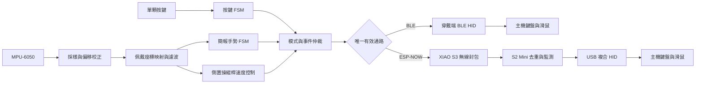
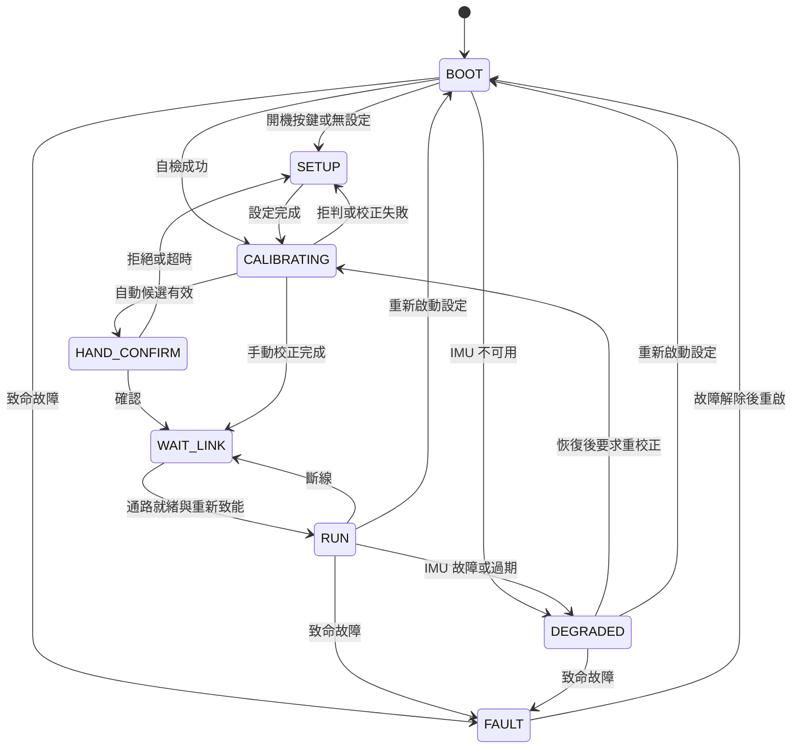
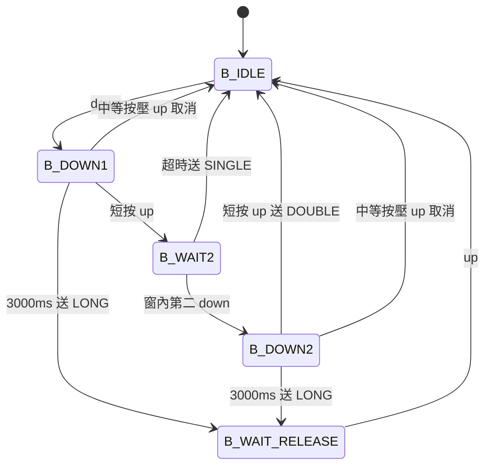
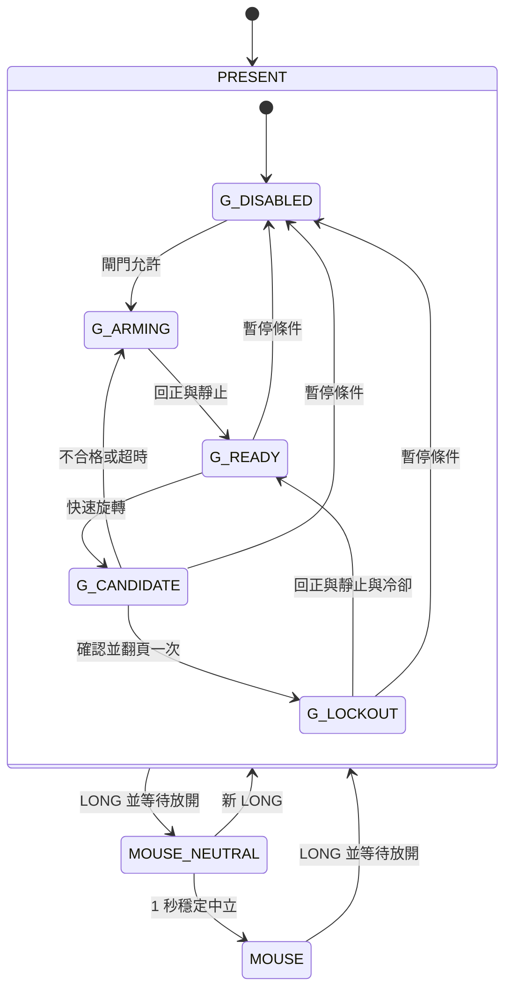
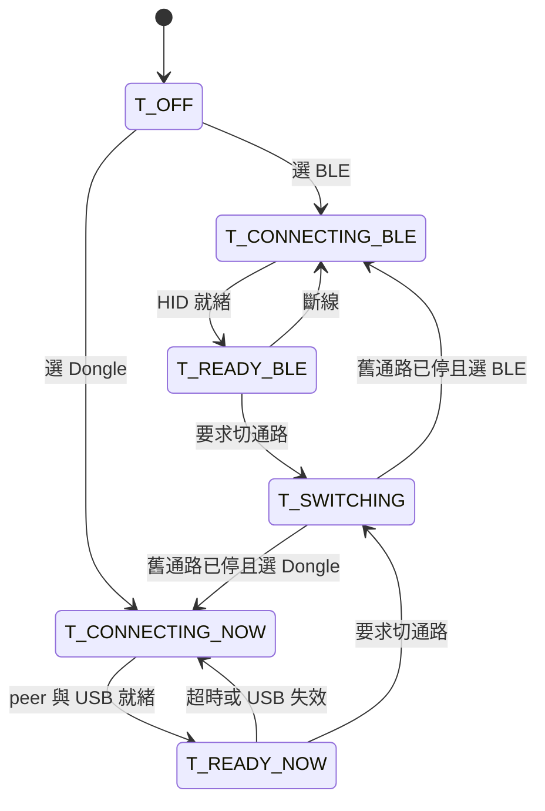

# 慧演 HuiYan｜產品需求文件（PRD）

文件版本：v1.0／規劃基準版  
更新日期：2026-11-10（Asia/Taipei）  
文件狀態：供需求審查、Prototype 開發與測試使用；未代表產品已完成或量產可行性已驗證。  
適用範圍：ESP32-C3 Prototype，以及 XIAO ESP32S3＋ESP32-S2 Mini Dongle 未來版。

## 1. 文件依據與證據分級

主要依據為原對話〈慧演產品定位整理〉：[原對話](chatgpt-conversation://6ac638a4-bf04-83ee-802f-307c46e3ad8e)。本次已讀取該對話所有可取得的 5 個回合。對話未附原始感測檔、韌體、接線照片或測試報告；不可由舊助理的技術可行性描述推論新功能已完成。

| 標記 | 定義 | 本文件處理方式 |
|---|---|---|
| U：使用者需求 | 使用者明確指定的材料、功能或操作 | 納入需求；矛盾處列待決 |
| H：歷史成果回述 | 原助理回顧先前實作／採集結果，但本次未取得原件 | 僅在歷史進度區勾選有限範圍，明示待補證；不視為新版驗收通過 |
| P：本 PRD 提案 | 為可實作性補充的流程、數值、備援與測試目標 | 待團隊審查；所有數字均非量測成果 |
| V：實測驗證 | 可追溯版本、樣本及紀錄支持的通過結果 | 本次沒有可直接查驗的 V 級證據 |

### 1.1 已知歷史成果與邊界

原助理於重新規劃評估中寫到「目前完成的 ESP32-C3、MPU-6050、微捏按鍵及左右旋轉資料採集」，並提及 `left.txt`、`right(1).txt`、GY 軸旋轉正負特徵及 V0.4 FSM。這些屬 H 級回述，不是本次重跑的測試結果。

因此，可記錄舊版基本硬體測試／採集曾完成；不能擴大解讀為左右手自動辨識、無致能翻頁、BLE HID、側置操縱桿滑鼠、雙模通訊或電池續航已通過。V0.4 的程式與實機狀態皆待補證。

## 2. 產品定位、價值與範圍

**產品定位：讓講者不必手持翻頁器，就能以穿戴裝置切換簡報與游標操作的互動控制器。**

核心價值是穩定翻頁、按鍵備援與必要時的游標點擊；正式演講中避免誤翻頁的優先度高於增加手勢數量。側置操縱桿滑鼠屬簡報現場的短時游標控制，不以精密繪圖、遊戲或全天候取代桌面滑鼠為目標。

| 優先度 | 內容 | 版本 |
|---|---|---|
| P0 | BLE HID 鍵盤＋滑鼠通路、單／雙／長按仲裁、可靠的簡報翻頁與按鍵備援 | Prototype |
| P0 | 固定佩戴座標、手動左右手設定、中立校正、失效時禁止異常輸出 | Prototype |
| P0 | 側置操縱桿速度控制、回正停止、左右鍵、模式可辨識 | Prototype |
| P1 | 有條件的左右手自動辨識、拒判及校正備援 | Prototype 研究；不得阻塞其他 P0 |
| P1 | XIAO S3 移植、ESP-NOW＋S2 USB HID、LiPo 與穿戴機構 | 未來版 |
| P2 | TinyML、額外震動回饋、更多手勢、多主機管理 | 驗證有需求後另立規格 |

非本版範圍：黑屏快捷鍵、拖曳、滾輪、三擊快捷鍵、雲端帳號、自動更新、同時控制兩台電腦。原較早對話曾提黑屏，但此次重新規劃未指定，不自動帶入。

## 3. 使用者與使用情境

| 使用者／場景 | 工作與操作 | 成功條件／失敗備援 |
|---|---|---|
| 教師、講師／教室 | 走動授課、左右快速翻腕上下頁 | 正常講解不誤翻頁；手勢失效時按鍵仍可用 |
| 商務簡報者／自己的筆電 | BLE 配對後直接簡報 | 開機後辨識連線與模式；不需 Dongle |
| 演講者／借用電腦 | 插入已配對 S2 Dongle，以 ESP-NOW 控制 | 標準 USB HID 可被該主機接受；無需專用應用程式，但受組織 USB 政策限制 |
| 展示者／網頁或互動簡報 | 長按切入滑鼠，傾斜移動、單擊選取、雙擊右鍵 | 能停止與精確點擊；回簡報不產生殘留操作 |
| 左／右手使用者 | 換手或重新佩戴後校正 | 相同語意的動作得到相同指令；不可偷偷反轉方向 |
| 拿麥克風、喝水或轉身時 | 自然動作、暫停操作 | 可暫停手勢；無意動作不構成翻頁 |

### 3.1 主要使用流程

1. 固定穿戴方向，開機；預設為簡報模式、BLE 通路，或使用已保存的通路設定。
2. 裝置完成自檢與連線；首次使用／換手時，指定左右手或執行指定姿態辨識。
3. 保持中立姿態至少 1 秒完成校正，確認就緒回饋後才允許動作輸出。
4. 以手勢或按鍵翻頁；長按 3 秒切換滑鼠模式，放開並完成中立取樣後操作游標。
5. 長按 3 秒返回簡報。要改通路或重新設定手別，進入設定流程，不與操作模式切換共用同一事件。

## 4. 硬體架構與電源

### 4.1 BOM 與責任分工

| 元件 | 目前 Prototype（U） | 未來版（U） | 工程要求 |
|---|---|---|---|
| 穿戴 MCU | ESP32-C3 Super Mini ×1 | XIAO ESP32S3 ×1 | 執行採樣、濾波、FSM、事件仲裁與通訊 |
| IMU | MPU-6050 ×1 | MPU-6050 ×1 | I²C 六軸資料；機構固定方向與座標版本化 |
| 按鍵 | 按鍵／微捏按鍵 ×1 | 按鍵 ×1 | GPIO 去彈跳；不得假設板上 BOOT 鍵等同外接操作鍵 |
| 接收器 | 無 | ESP32-S2 Mini ×1 | ESP-NOW 接收，USB 複合鍵盤＋滑鼠 HID |
| 電源 | USB 供電驗證（P） | 單節 3.7V LiPo | 穿戴端電池；Dongle 由主機 USB 供電 |
| 回饋 | 先核對板載 LED；不足時以 USB 診斷工具輔助 | 可辨識的狀態指示為必要需求 | LED 可視性／數量待查；震動元件未列原 BOM |

ESP32-C3 支援 BLE，可利用 HID 韌體實現鍵盤與滑鼠；實際 SDK／函式庫、描述符及主機相容性仍需驗證。[C3 資料表][S1]、[官方 BLE HID 範例][S2]。C3 的原生 USB Serial/JTAG 不等同可任意實作 USB HID Device，不將它規劃成 S2 的直接替代品。[USB 能力說明][S3]

S2 沒有 BLE 無線能力，因此未來 Dongle 路徑必須為 ESP-NOW → USB HID，不能畫成 BLE → S2。[S2 資料表][S4]。S2 支援 USB Device 的硬體條件不代表特定 Mini 板、USB 接頭與所選韌體已驗收；須確認 USB 資料線、腳位、枚舉與鍵鼠報告。[USB 能力說明][S3]

### 4.2 接線與整合要求

- 在建立接線表前，先確認 Super Mini／S2 Mini 實際板型與版本；本文件不虛構固定 GPIO 配置。
- MPU-6050 的 SDA、SCL、電源、接地及可選 INT 需明確標示；確認模組是否有穩壓、I²C 上拉及其上拉電壓。邏輯介面以對 MCU 安全的 3.3V 為基準；不可僅因模組標註可接 5V 就假設匯流排也是安全的。
- 記錄感測器地址、WHO_AM_I、取樣率、量程、濾波器與軸向；上電檢查未通過不得啟用 IMU 操作。
- 按鍵採可控的上／下拉與去彈跳，避開會造成啟動模式異常的腳位。電源與無線峰值負載下需無異常重啟。
- 最終固定位置、束帶鬆緊及 PCB 軸向皆屬演算法輸入條件；任何機構變更均需重做映射與校正驗證。

### 4.3 電池與充電

XIAO ESP32S3 提供電池連接與充電相關功能，但應按實際板本的官方接法、電池極性及充電規格設計。[Seeed 官方說明][S5]。3.7V 為標稱值，一般單節 LiPo 的滿充電壓約 4.2V；不得將電池直接接入 3V3 腳。

未來版需核對：電池容量與保護、充電電流是否符合電芯、欠壓截止、短路保護、充電時帶載行為、USB 與電池切換、固定與防拉扯。低電量門檻須依電芯與電源路徑量測後決定，不以未校正 ADC 電壓直接宣稱剩餘百分比。

續航估算先用「可用容量 mAh ÷ 平均電流 mA」估算小時，再以含穩壓損失、LED、IMU、射頻與待機的完整樣機測試確認。電池容量、重量與實測電流目前未定，不能宣稱已達任一續航。

## 5. 軟體、座標與輸出架構

資料路徑：IMU／按鍵 → 時戳與校正 → 裝置座標轉使用者座標 → 手勢／滑鼠運算 → 事件仲裁 → 單一有效通路 → HID 報告。



### 5.1 座標與採樣提案（P）

- 裝置軸 `X_d/Y_d/Z_d` 依 PCB 絲印、安裝照片與旋轉右手定則記錄。舊資料中的 GY 只表示該次安裝軸，不保證新機構仍使用 GY。
- 使用者座標以「朝使用者感知右方的有效快速翻腕＝下一頁」為語意，左右手分別建立經校正的映射；不得只對某一軸盲目乘以 -1。
- 初始採樣 100Hz，使用單調時鐘；建議加速度 ±4g、角速度 ±1000°/s，依飽和率及解析度調整。單位固定為 g、°/s、°，原始值與換算參數皆可追溯。
- 開機靜止校正取得陀螺儀偏移；互補濾波或等效融合估算相對重力傾角。動態加速度大時降低對加速度姿態修正的信任。
- 使用 Δt 計算積分與速度；不得依固定迴圈次數假設時間。資料過期超過 100ms 立即中止 IMU 輸出；缺樣不以補值造成手勢或大位移。
- 加速度與角速度、校正版本、手別、模式、FSM 狀態、輸出事件與連線事件應有診斷紀錄；使用者原始動作資料預設留在本機。

## 6. 左右手自動辨識、局限與校正備援

### 6.1 能力邊界

MPU-6050 為三軸加速度計＋三軸陀螺儀，沒有磁力計。[MPU-6050 規格][S6]。六軸量測不能唯一識別左右手：兩手在不同佩戴／手腕姿態下可能給出相同重力與角速度。靜止重力能約束部分傾斜，不能提供不漂移的絕對航向；長時間積分陀螺儀也會累積偏移。

上述可觀測性限制是本 PRD 的工程推論；加入分類模型不能消除本來就重疊的資訊。自動辨識只在固定安裝、明定校正姿態與已測試族群下作條件式推測，不能宣稱任意佩戴皆能辨識。

### 6.2 需求 HY-HAND

1. 「常駐」解釋為持續監看資料健康與校正有效性；**不在操作中持續改變左右手設定**。
2. 每次啟動／換手時，先採指定姿態：前臂自然向前、掌心向下、裝置標記朝指定方向，靜止至少 1 秒；照片與角度容許範圍須由機構定版。
3. 演算法輸出左／右／未知及信心值。未經標註驗證的信心分數不視為正確機率；門檻必須以保留測試資料決定。
4. 高信心時先顯示候選手別，使用者確認後鎖定至此次使用結束。低信心／佩戴不符時拒判，進入手動選擇，不能默默猜測。
5. 使用者可手動指定左／右；此路徑不依賴自動分類成功，可繼續驗證完整產品功能。
6. 運作期間異常姿態或機構疑似滑動時提示重新校正；無法只靠 IMU 保證偵測所有滑移。換手、重戴或裝置移位時，由使用者主動重新校正。
7. 保存的手別只作下次設定初值，仍須確認；中立姿態每次重新取樣。自動辨識無法達標時，第一版以手動左右手設定出貨，移除全自動宣稱。

### 6.3 單鍵設定與回饋提案（P，待 UX 驗證）

為避免把 3 秒長按同時用於重校正及通路切換，設定僅從開機入口進入：上電時按住操作鍵達 3 秒，進入 `SETUP`；此時沒有任何主機 HID 輸出。Prototype 由 USB 診斷工具顯示選項；未來版必須補上使用者看得到的獨立狀態回饋，否則不能宣稱可脫離工具設定。

設定項依序為「左手／右手／自動」、「BLE／Dongle」、「手勢啟用／手勢暫停」；C3 Prototype 不提供 Dongle 選項。單擊輪替，長按 3 秒確認並移到下一項；最後進入校正。設定中不使用雙擊語意，每次確認後均等放開；30 秒無輸入取消，沿用上次有效設定，無有效設定則保持禁止輸出。

自動手別若成功，在校正結果頁單擊確認；失敗或再次長按則返回手別設定。要在使用中換手、改通路、重新定中立，第一版採重新啟動並進設定流程。這是可實作備援，效率與可用性需測試；正式版可另加設定介面，但不得佔用既定 3 秒切模式操作。

建議狀態回饋語意：簡報／滑鼠、未連線、校正中、左／右／未知、電量不足與故障都須可區分；實際 LED 編碼／顯示方式列 D-04。不可假設現有 BOM 已含震動器或多色燈。

## 7. 操作規格與按鍵仲裁

### 7.1 操作表

| 模式 | 動作 | 主機事件 | 證據與狀態 |
|---|---|---|---|
| 簡報（開機預設） | 使用者座標向右快速有效旋轉 | Page Down／下一頁 | U 要求上下頁；方向對應採原助理提案，待實測確認 |
| 簡報 | 使用者座標向左快速有效旋轉 | Page Up／上一頁 | 同上 |
| 簡報 | 單擊 | 下一頁一次 | U |
| 簡報 | 雙擊 | **待決 D-01** | U 原文單擊、雙擊都為「下一頁」；不可自行當成筆誤 |
| 滑鼠 | 相對中立的左右／前後傾斜 | 相對游標移動 | U 側置操縱桿概念；速度模型為 P |
| 滑鼠 | 單擊 | 左鍵按下＋放開一次 | U；不是按住拖曳 |
| 滑鼠 | 雙擊 | 右鍵按下＋放開一次 | U；不是送兩次左鍵，也不是 OS 雙擊 |
| 任一操作模式 | 連續按住滿 3 秒 | 簡報 ↔ 滑鼠一次 | U；持續按住不重複切換 |

Page Up／Down 在簡報放映、瀏覽器及應用焦點下行為可能不同；驗收須指定軟體與視窗焦點。產品不自動搶焦點。每一鍵盤／滑鼠點擊均需送對應釋放報告，避免黏鍵。

**D-01 的處置：**

- 保留原需求方案：雙擊＝下一頁一次，與單擊同功能，確認雙擊時不能先送單擊再送雙擊，否則會跳兩頁。
- 建議待批准方案：單擊＝下一頁、雙擊＝上一頁，才能形成無手勢備援。
- 研究用可設定 `presentation_double_action = NEXT | PREVIOUS | NONE`，每份測試紀錄都要註明。未決期間不得把 `PREVIOUS` 當成既定需求；整版操作驗收須待 D-01 結案。

### 7.2 時間參數提案（均為 P）

| 參數 | 初值 | 定義 |
|---|---|---|
| 去彈跳 | 20ms | 電位持續穩定後才接受 down／up，事件時間取確認時刻 |
| 雙擊窗 | 300ms，可測 250–350ms | 第一次有效 up 到第二次有效 down 的最長間隔 |
| 短按最長時間 | 500ms | down 至 up 不超過此值才可構成點擊 |
| 長按門檻 | 3000ms | 從有效 down 起算；滿門檻當下觸發，不等放開 |
| 過長但未滿長按 | >500ms 且 <3000ms | 放開僅取消，不產生單／雙擊 |
| 點擊抑制移動 | down 起至解析結束後 100ms | 滑鼠暫停位移，期間不累積待補位移；依人因結果調整 |

單擊必須等雙擊窗結束才送出，因此有約 300ms 固有延遲。不能先送左鍵再試圖撤回成右鍵。長按的優先權高於任何待決點擊；第一短按後，若第二按持續滿 3 秒，取消第一短按並只切換模式。第二按雖在雙擊窗內開始，若持續超過 500ms 且未滿 3 秒就放開，兩次皆取消，以避免不明確操作造成誤指令。

同一 tick 同時出現 up 與滿 3000ms，先判長按。第二 down 恰在 300ms 邊界可算雙擊候選；超過後視為新序列。三次快速短按解讀為一次雙擊加一個新的單擊候選，不另設三擊命令。

### 7.3 事件優先權與互斥

1. 致命電源／系統故障、設定與斷線閘門優先於所有輸出；IMU 故障優先停 IMU，但可保留已連線的按鍵備援。
2. 長按切模式時清除點擊、手勢候選、冷卻與位移；盡力釋放主機鍵鼠並等待按鍵放開。
3. 任何有效按鍵 down 起暫停手勢辨識，整段按鍵序列完成／取消後，再靜止 300ms 才重新致能；避免按鍵操作帶動手腕又翻一頁。
4. 簡報手勢與滑鼠控制永遠不在同一操作模式並行輸出；BLE 與 ESP-NOW 永遠只有一個有效輸出通路。
5. 斷線期間不排隊操作；重連後不補送舊翻頁或游標資料。

## 8. 簡報手勢規格

使用「靜止 → 有方向的快速旋轉 → 確認 → 單次翻頁 → 回正與冷卻」；不得以單一瞬間 GY 過門檻直接翻頁。兩手均先轉成一致的使用者座標。

初始參數（P）：靜止為角速度向量 <15°/s 且加速度大小在 0.9–1.1g，持續 300ms；起動角速度 120°/s；旋轉時間 80–500ms；有效方向旋轉累積量 20–70°；方向一致性至少 80%；主要軸能量占比至少 65%；候選等待結束／速度降到 40°/s 以下才確認。各門檻需依標註資料調整，不能視為現有資料已證明。

確認後只送一次 Page Up／Down。回轉不觸發反向翻頁，必須距中立 ≤10°、符合靜止條件 300ms，且距上次輸出 ≥600ms 才重新致能。相反方向確有需要時仍須完成重新致能流程。候選超時、方向反覆、感測飽和或資料過期一律取消，不猜測指令。

無按鍵致能版先視為高風險實驗。若誤翻頁未達 AC-04，預設採「手勢暫停＋按鍵操作」或另立微捏致能方案；微捏致能可能與單／雙擊產生衝突，需另做輸入規格，不能直接塞入現行 FSM。

## 9. 滑鼠：側置操縱桿速度模式

### 9.1 控制模型（P）

選用相對重力可觀測的兩個傾斜自由度：左右傾斜控制 X，前後傾斜控制 Y。保持傾斜會持續移動，回中立即停止；不以繞重力軸的絕對航向作長期控制基準，也不採雙重積分估算手的空間位置。

進入滑鼠時先釋放按鍵，再保持中立至少 1 秒取樣；校正完成前沒有位移。非靜止時延長等待，5 秒內無法取得有效中立則停在校正提示，不使用舊值強制啟動。

每軸相對角度 θ 的初始曲線：

```text
e = max(0, abs(θ) - 4°)
v = sign(θ) × 800 × min(e / (25° - 4°), 1)^1.5  像素/秒
當 abs(θ) <= 3° 時回到停止；再次超過 4° 才啟動。
每幀相對位移 = v × Δt，保留小數餘數，不累積被抑制的位移。
```

最大速度 800 px/s、停止／啟動遲滯 3°／4°、25° 滿速及曲線指數 1.5 都是調校初值。HID 輸出是相對計數；像素效果受 OS 游標速度、縮放與加速影響，必須固定主機設定後校準計數對像素的換算。報告超範圍時分段或限幅，避免整數溢位。

### 9.2 行為要求

- 左右手均需完成方向校正；不能因換手導致上下／左右反轉。
- 中立區內輸出零位移，不以不斷自動重設中立掩蓋傾斜控制；否則持續傾斜會自行停止。
- 點擊時套用移動抑制，結束後重新以當前姿態計速，不補送抑制期間距離。
- 按鍵實體長按只用來切模式，不送滑鼠持續按住；本版無拖曳、無左鍵雙擊捷徑。
- 模式切換、斷線、校正、感測過期時停止游標並釋放滑鼠鍵；接收器也需有獨立 watchdog。
- 首版以重新進設定執行重定中立；若疲勞測試顯示需要即時暫停／離合器，列為下一次輸入設計的必要改版，避免臨時新增衝突手勢。

## 10. 完整 FSM 設計

採分層＋正交狀態機，避免把「手別、通路、模式、按鍵」混成單一龐大狀態。系統狀態為 `生命週期 × 通路 × 操作模式 × 按鍵解析 × 手勢狀態`，由本節的閘門與優先權限制合法組合。

### 10.1 全域規則

- 每輪先處理故障／斷線，再處理長按、按鍵、模式，再處理 IMU；同一事件最多被消耗一次。
- 未列出的輸入預設維持狀態且不輸出；不是自動跳回簡報。計時器使用單調時鐘並能處理溢位。
- `CLEAR`：清掉候選、點擊與相對位移，能傳送時送全鍵釋放；不能傳送時標記新連線第一包先釋放。Dongle 超時也本地釋放。
- 輸出閘門：僅 `RUN` 或按鍵備援的 `DEGRADED`，且通路 `READY`、不在等待放開／設定／校正時才可輸出。IMU 另需健康、手別映射有效且中立校正有效。
- 模式預設簡報；不從非揮發記憶體恢復成滑鼠。通路與使用者手別可保存，但不得保存未解析按鍵或手勢。
- BOOT 在上電按鍵入口判定結束前不啟用操作，避免尚在等 3 秒時已送出點擊。所有「等待放開」完成後，原本那次按壓必須已被消耗。
- DEGRADED 內長按仍可切換簡報／滑鼠的按鍵語意，但不進入依賴 IMU 的 MOUSE_NEUTRAL；游標永遠停住，單／雙擊備援仍可使用。IMU 恢復需另行重校正才啟用位移。

### 10.2 生命週期、設定與校正 FSM

| 狀態 | 事件／條件 | 動作 | 下一狀態 |
|---|---|---|---|
| OFF | 供電／啟動 | 清狀態、載入有效設定、禁止 HID | BOOT |
| BOOT | 上電鍵持續滿 3 秒 | 進設定，等待放開 | SETUP |
| BOOT | 未要求設定，自檢成功且已有手別設定 | 啟動選定通路，開始中立校正 | CALIBRATING |
| BOOT | 無有效設定 | 要求手別／通路設定 | SETUP |
| BOOT | IMU 自檢失敗，系統與按鍵健康 | CLEAR，開啟選定通路，提示只用按鍵 | DEGRADED |
| BOOT／任意活動狀態 | 致命系統錯誤或供電低於可靠工作範圍 | CLEAR、停止無線／關機流程 | FAULT |
| SETUP | 鍵放開後單擊 | 輪替當前選項，不發 HID | SETUP |
| SETUP | 長按 3 秒 | 保存此項，等待放開後移到下一項；最後一項開始校正 | SETUP／CALIBRATING |
| SETUP | 30 秒無輸入 | 有舊設定則取消修改並校正；無則保持待設定 | CALIBRATING／SETUP |
| CALIBRATING | 手動手別有效且靜止 ≥1 秒 | 保存此次中立；凍結手別映射 | WAIT_LINK 或 RUN |
| CALIBRATING | 自動辨識高信心且姿態有效 | 顯示候選，等待確認 | HAND_CONFIRM |
| CALIBRATING | 自動辨識拒判／5 秒超時 | 顯示未知，改手動／重試 | SETUP |
| HAND_CONFIRM | 單擊確認 | 鎖定手別與中立；消耗按鍵，等放開 | WAIT_LINK 或 RUN |
| HAND_CONFIRM | 長按／拒絕／30 秒無確認 | 取消候選，不猜測 | SETUP |
| WAIT_LINK | 通路 READY | CLEAR、按鍵放開且靜止 300ms 後致能 | RUN |
| RUN | 操作模式長按事件 | CLEAR，切模式，等待放開；進滑鼠需重新中立校正 | RUN（輸出暫停） |
| RUN | 模式為滑鼠且等放開結束 | 啟動 1 秒滑鼠中立取樣；未完成前閘門關閉 | RUN（校正子狀態） |
| RUN | 通路斷線 | CLEAR，不排隊，保留操作模式但停止輸出 | WAIT_LINK |
| RUN | IMU 過期 >100ms／讀取故障 | CLEAR，停手勢與游標，保留按鍵語意 | DEGRADED |
| DEGRADED | 按鍵／連線健康 | 只允許按鍵與模式切換；提示 IMU 不可用 | DEGRADED |
| DEGRADED | 通路斷線／重連 | CLEAR，關閉／重新開啟按鍵輸出閘門 | DEGRADED |
| DEGRADED | IMU 恢復健康且使用者要求重校正 | 不立即恢復，重新校正 | CALIBRATING |
| WAIT_LINK／RUN／DEGRADED | 主動重新啟動進設定 | CLEAR；重新從開機設定 | BOOT |
| FAULT | 重啟且故障條件解除 | 重新自檢 | BOOT |
| 任意活動狀態 | 移除供電 | 不保存未完成動作；接收端自行超時釋放 | OFF |

若校正完成時連線已 READY，直接進 RUN；否則 WAIT_LINK。滑鼠模式中的中立校正為 RUN 的輸出暫停子狀態，成功後才恢復 IMU 閘門；5 秒失敗則停留提示並容許長按回簡報，不自動移動。



圖為主要路徑；全狀態致命故障、斷電與校正後直接 RUN 的條件以狀態表及全域規則為準。

### 10.3 按鍵 FSM

| 狀態 | 事件／條件 | 動作 | 下一狀態 |
|---|---|---|---|
| B_IDLE | 有效 down | 記錄 t_down，暫停手勢及游標 | B_DOWN1 |
| B_DOWN1 | up，持續 ≤500ms | 不輸出，開啟 300ms 雙擊窗 | B_WAIT2 |
| B_DOWN1 | up，500ms<持續<3000ms | 取消序列 | B_IDLE |
| B_DOWN1 | 持續 ≥3000ms | 產生 LONG 一次，清候選 | B_WAIT_RELEASE |
| B_WAIT2 | 第二 down，間隔 ≤300ms | 取消單擊計時，記錄第二次 down | B_DOWN2 |
| B_WAIT2 | 窗口逾時且沒有第二 down | 產生 SINGLE 一次 | B_IDLE |
| B_DOWN2 | up，第二次持續 ≤500ms | 產生 DOUBLE 一次，不產生 SINGLE | B_IDLE |
| B_DOWN2 | up，500ms<持續<3000ms | 取消整段，不補第一單擊 | B_IDLE |
| B_DOWN2 | 第二次按住 ≥3000ms | 產生 LONG 一次；取消第一短按 | B_WAIT_RELEASE |
| B_WAIT_RELEASE | 仍按住 | 不輸出、不重複長按 | B_WAIT_RELEASE |
| B_WAIT_RELEASE | 有效 up | 啟動重新致能／模式校正 | B_IDLE |
| 任意 B 狀態 | 設定、斷線、故障、外部 CLEAR | 不發點擊；若仍按住則先等放開 | B_WAIT_RELEASE 或 B_IDLE |

在 SETUP、HAND_CONFIRM 中使用相同去彈跳與長按底層，但由設定狀態消耗事件，不送操作命令。離開設定或重連時按住的鍵不構成新長按；必須先放開。



### 10.4 操作模式與簡報手勢 FSM

| 狀態 | 事件／條件 | 動作 | 下一狀態 |
|---|---|---|---|
| PRESENT | SINGLE | 下一頁一次 | PRESENT |
| PRESENT | DOUBLE | 依 D-01 已選定配置；未選定不作正式驗收 | PRESENT |
| PRESENT | LONG | CLEAR，停止手勢，等放開 | MOUSE_NEUTRAL |
| MOUSE_NEUTRAL | 放開且穩定 1 秒 | 設定滑鼠中立、啟用速度控制 | MOUSE |
| MOUSE_NEUTRAL | 超時／動態姿態 | 零位移，顯示校正未完成 | MOUSE_NEUTRAL |
| MOUSE_NEUTRAL | LONG（新按壓） | CLEAR，返回簡報，等放開與靜止 | PRESENT |
| MOUSE | 有效姿態樣本 | 依曲線送相對位移 | MOUSE |
| MOUSE | SINGLE／DOUBLE | 左／右鍵完整點擊一次，套用移動抑制 | MOUSE |
| MOUSE | LONG | CLEAR，停止游標，等放開與靜止 | PRESENT |
| 任意模式 | 斷線／IMU 故障 | 保留語意模式，但關閉對應輸出閘門 | 原模式（暫停） |

| 手勢子狀態 | 事件／條件 | 動作 | 下一狀態 |
|---|---|---|---|
| G_DISABLED | 簡報、健康、已校正、通路 READY、無按鍵序列且手勢已啟用 | 開始靜止判定 | G_ARMING |
| G_ARMING | 靜止 300ms 且回中立 | 清積分與方向，允許候選 | G_READY |
| G_ARMING | 仍在動態／未回正 | 不輸出 | G_ARMING |
| G_READY | 主軸角速度過起動門檻 | 保存方向與 t0，開始有限窗積分 | G_CANDIDATE |
| G_CANDIDATE | 時間、旋轉量、方向與主軸條件全通過且速度已下降 | 只送一次翻頁，記錄時間 | G_LOCKOUT |
| G_CANDIDATE | 超時／反轉／飽和／不符條件 | 不輸出；要求重新靜止 | G_ARMING |
| G_LOCKOUT | 未同時滿足回正、靜止與冷卻 | 忽略回轉，不產生另一頁 | G_LOCKOUT |
| G_LOCKOUT | 全部重新致能條件成立 | 清候選 | G_READY |
| 任意 G 狀態 | 按鍵 down／模式改變／資料不健康／斷線／手勢暫停 | 清候選、禁止手勢 | G_DISABLED |



### 10.5 通路 FSM（與操作模式正交）

| 狀態 | 事件／條件 | 動作 | 下一狀態 |
|---|---|---|---|
| T_OFF | 載入有效 BLE 選擇 | 僅啟動 BLE 廣播／配對 | T_CONNECTING_BLE |
| T_OFF | 載入有效 Dongle 選擇 | 僅啟動指定 ESP-NOW peer／頻道 | T_CONNECTING_NOW |
| T_CONNECTING_BLE | 已連線、加密／配對與 HID 通知可用 | 先全釋放，不補舊事件 | T_READY_BLE |
| T_CONNECTING_NOW | 雙向 session 握手及 Dongle USB ready | 清序號視窗，確認活動 peer | T_READY_NOW |
| T_CONNECTING_* | 尚未連上 | 提示連線中，限制重試速率；不輸出 | 原狀態 |
| T_READY_BLE | BLE 斷線／HID 不可用 | CLEAR，關輸出閘門 | T_CONNECTING_BLE |
| T_READY_NOW | 心跳超時 500ms／USB 未就緒 | CLEAR；接收器本地釋放 | T_CONNECTING_NOW |
| 任意 T 狀態 | 設定要求改通路 | CLEAR、關閉舊通路、銷毀舊 session | T_SWITCHING |
| T_SWITCHING | 舊輸出已停 | 啟動選定新通路，不自動回退到另一台主機 | T_CONNECTING_BLE／NOW |
| 任意 T 狀態 | 系統關機／FAULT | 停止發送、能送則釋放 | T_OFF |

Runtime 不提供自動通路切換；從設定流程切換。D-03 若改成熱切換，仍必須先停舊通路並重新握手。



## 11. BLE 與 ESP-NOW 通訊需求

### 11.1 BLE HID 直連

Prototype 使用 C3 作 BLE HID peripheral；主機為 HID host。需同時有鍵盤翻頁與相對滑鼠報告，Report ID、按下／放開與訂閱行為皆明確；記錄所選 SDK 版本、HID 描述符與主機配對流程。[官方範例][S2]

保存 bonding 資料與提供清除配對的設定入口；清除配對不得在演講中意外觸發。初次配對只在使用者操作後允許，以避免連錯主機；配對窗口與識別方式列 D-03。斷線時所有輸出停止，重新連線先全釋放，再要求放開／靜止重新致能。主機顯示已連線不等於 HID 可用，需確認通知／報告通路。

### 11.2 ESP-NOW＋USB Dongle

未來穿戴端 XIAO S3 作事件產生端；S2 Mini 作指定接收器與 USB 複合 HID device。ESP-NOW 不需外部 AP，但雙方需相容的頻道與 peer 設定。官方說明指出發送 callback 成功不保證應用層已收到，可靠命令需自行設計 ACK、超時與序號。[ESP-NOW 文件][S7]

**協定初稿（P）：**

| 欄位 | 用途 |
|---|---|
| protocol_version、message_type、payload_length | 驗證相容性、類型與長度 |
| device_id、session_id | 綁定來源；每次重啟／重連建立新 session，排除舊封包 |
| sequence_id／event_id | 此 session 中單調遞增，重傳沿用原 ID |
| timestamp／有效期 | 有限壽命；時鐘未同步時以 session 與接收端 age 界線實作，不直接比較兩顆 MCU 絕對時鐘 |
| mode、command／mouse_delta、button_state | 明確動作與模式，拒絕非法組合 |
| ACK event_id、狀態／錯誤碼 | 確認事件被接收及處理，不冒稱應用畫面一定成功 |

離散翻頁／點擊：初始 ACK 等待 30ms、最多追加重傳 2 次、事件有效期 200ms；在同一 session 保留去重視窗至少 2 秒，重複封包只回 ACK 不再輸出 HID。下個事件使用新 ID。持續滑鼠位移：建議 50Hz，沿用序號去重，但不重送過期位移；超過 100ms 的位移丟棄，避免延遲後游標跳動。實際速率與參數必須以量測調整。

S2 每 100ms 心跳或等效資料健康檢查，500ms 無有效來源則停止游標、釋放所有鍵，退出 ready。USB 未枚舉／主機睡眠時不累積操作；恢復後重新握手並清空緩衝。封包 callbacks 只做短處理／入列，HID 與計算在工作任務執行。[ESP-NOW 文件][S7]

在重啟、掉電或 HID 已送出但 ACK 尚未送達的邊界，僅靠 RAM 去重不能保證跨 session 的「恰好一次」。規格選擇重啟後丟棄舊 session 與舊事件，不重播；可能漏掉一個指令，禁止為補償而重複翻頁。接收 ACK 代表軟體已處理，不代表 PowerPoint 一定消費了該按鍵。

指定 peer、受控配對及可用的 ESP-NOW 單播加密應納入產品版；MAC 篩選不是完整身分驗證。配對只在明確窗口內開啟，不在演講時接受任意控制來源。對多台同場裝置須驗證不交叉控制。

### 11.3 雙模原則

BLE 與 ESP-NOW 都在 2.4GHz 資源下工作。第一版採互斥通路，減少共存、耗電與重複控制；互斥不代表完全沒有外部 Wi-Fi／藍牙干擾。不宣稱 ESP-NOW 必然比 BLE 更快、省電或穩定，兩條路徑分別量測延遲、可靠度與電流。

## 12. 技術風險與緩解

| 風險 | 影響／優先度 | 緩解與驗證 | 未達標決策 |
|---|---|---|---|
| 左右手資訊重疊 | 方向反轉，高 | 指定姿態、固定機構、拒判、手動鎖定；保留人員測試 | 停止全自動宣稱，以手動為預設 |
| 無致能手勢誤觸 | 演講中跳頁，最高 | 完整時間窗、回正、冷卻、負樣本與長時自然演講測試 | 預設暫停手勢／另設致能版 |
| 回轉被辨識第二次 | 一次動作跳兩頁，高 | LOCKOUT 且回正後才重啟 | 不得進展示版 |
| 六軸航向漂移 | 游標持續偏移，高 | 使用重力傾角兩軸、中立校正、死區；不使用絕對 yaw | 調整控制模型與機構姿態 |
| 點擊擾動手腕 | 點錯目標，高 | 點擊時凍結位移、穩定按鍵位置，量測目標點擊 | 改按鍵／機構或速度曲線 |
| 單雙擊延遲與認知衝突 | 左鍵慢、右鍵誤觸，中高 | 延遲解析、不搶先送單擊，調窗並人因測試 | 檢討輸入方法，不隱藏延遲 |
| 單鍵承載太多 | 模式／設定混淆，高 | 3 秒專用切模式，設定僅開機入口，明確回饋 | 增加回饋／控制元件前先更新 BOM |
| BLE／主機差異 | 配對成功但不能操作，中高 | 固定版本矩陣、報告測試、重新配對流程 | 縮小支援範圍並標示 |
| ESP-NOW 丟包／重傳 | 漏頁／重複頁，高 | ACK、去重、session、期限與斷線測試 | 不接受無去重 Dongle |
| USB 重插／主機睡眠 | 黏鍵與延後補送，高 | 全釋放、watchdog、清 buffer、ready 握手 | 修復前不可產品化 |
| 穿戴滑移／手大小差異 | 映射失效、疲勞，高 | 固定方向、防滑與多手型測試；校正提示 | 調整機構，不靠模型硬補 |
| MPU 模組品質／供應 | 漂移或批次差異，中高 | 板批記錄、自檢、偏移與噪聲抽測，評估替代料 | 換料後重做資料與驗收 |
| 電池、無線峰值、充電熱 | 重啟／不可用，高 | 電源量測、保護與電芯匹配、帶載充電試驗 | 未有合格紀錄不開放穿戴充電使用 |
| 數據過擬合 | 實驗室好、現場差，高 | 依使用者分割資料，保留不同日／手別／環境 | 增採集或縮小使用條件 |

## 13. 可靠性、人因與可維護性

- **誤觸優先管理：** 同時報告漏判與誤判，不能只展示訓練資料準確率。自然演講負樣本需涵蓋指向螢幕、比手勢、拿麥克風、喝水、轉身與走動。
- **模式感知：** 使用者不看除錯視窗也應知道當前模式、是否連線及是否可操作；Prototype 可先工具顯示，未來版須獨立完成。切換回饋須在 3 秒門檻後立即出現。
- **疲勞：** 支援自然前臂姿態，不要求持續大角度扭腕；測試最大舒適角、30 分鐘疲勞與換手。若痛感或麻木出現，結束該次試驗並記錄，不用來追求測試時長。
- **失效退路：** IMU 故障時保留按鍵；無手別校正時禁止 IMU，提供設定入口；失聯時禁止排隊。產品不能以「自動辨識尚未成功」阻塞基本翻頁演示。
- **設定一致性：** 手別、軸向、門檻、速度曲線及通路協定需版本化；配置不相容時拒絕載入並提示，不以不明預設繼續。
- **韌體健全性：** 使用有界緩衝、watchdog 與事件日誌；量測 IMU 採樣與通訊是否互相阻塞；長時測試不得出現記憶體持續增加、漏釋放或重啟。
- **資料治理：** 採集檔需包含匿名受測者、左右手、佩戴照片／方向代碼、裝置／韌體版本、情境、時間戳、標籤與同意範圍；對外分享移除可識別資訊。

## 14. 量測方法與驗收準則

**以下全部是 P 級目標，尚未驗收。** 數值待需求審查後凍結；任何調整須記錄原因，不以放寬門檻偽裝通過。

### 14.1 共通測試條件

- Prototype 先以一台確定版本的 Windows 11 電腦、指定 PowerPoint 放映及指定 Chrome／Google Slides 測試；記錄 OS build、瀏覽器／應用版本、BLE adapter、距離、韌體與電池／USB 供電條件。這是驗證矩陣提案，不代表已支援。
- 其他 OS（macOS、Linux）、其他簡報軟體及組織管理電腦先列未驗證。未來版相同主機分別測 BLE／Dongle。
- 滑鼠測試固定 1920×1080、100% 縮放、固定游標速度並關閉加速；變更設定需另列結果，不直接混算像素數。
- 至少 5 名受測者，涵蓋左右手與不同手型；手勢每人每手每方向 50 次，共至少 1000 次。先用開發資料調參，驗收時參數凍結；若做分類模型，至少保留 2 名未參與調參者，另報其結果。
- 成功定義為主機收到正確、唯一且對應應用行為的事件；同一動作多送一次算失敗且列重複誤觸，不能以「有辨識到」算成功。保留 confusion matrix、漏判、反向、重複與誤輸出數。
- 時間量測用同一時基的韌體事件與主機輸入紀錄，或同步高速錄影；報告樣本數、p50、p95、最大值。分清識別／按鍵等待時間及通訊延遲，不能混算。

### 14.2 驗收表

| ID | 項目 | 測試方法 | 通過準則（提案） | Gate |
|---|---|---|---|---|
| AC-01 | IMU 採樣與資料健康 | 100Hz 連續 30 分鐘，記錄時間戳；注入 I²C 中斷 | 有效樣本 ≥99%；缺樣 >100ms 後 50ms 內停止 IMU 輸出；不產生突跳 | G1 |
| AC-02 | 按鍵單／雙擊 | 單、雙各 100 次，涵蓋兩操作模式與 250／300／350ms 邊界；另用可重現事件驗證極限 | 每類正確率 ≥99%；雙擊不得先送單擊；500–3000ms 中等按壓無點擊 | G1 |
| AC-03 | 長按與模式切換 | 每模式 50 次，含持續 10 秒、邊界放開、第二按長按 | 每次恰切一次；3 秒門檻處理誤差 ≤50ms；多餘鍵鼠事件 0 | G1 |
| AC-04 | 自然演講誤翻頁 | 每人每手 20 分鐘，含指定負樣本，共至少 200 分鐘 | 每段誤翻頁 0；任何一次即回開發，不以平均稀釋 | G2 |
| AC-05 | 有意手勢翻頁 | 共 ≥1000 次，分手別／方向報告 | 總正確率 ≥95%，每手每方向 ≥90%；回轉重複輸出 0 | G2 |
| AC-06 | 翻頁延遲 | 手勢物理結束至畫面變化 ≥100 次；按鍵另量 | 手勢 p95 ≤250ms；單擊從第一次 up 至畫面 p95 ≤450ms（含 300ms 窗） | G2 |
| AC-07 | 手別／拒判與備援 | 每人每手重新佩戴 30 次，共 300 次；另加 ≥50 次錯誤／含混姿態 | 有效姿態自動覆蓋率 ≥90%；已接受結果正確率 ≥98%；含混姿態至少 90% 拒判；操作中手別自動變更 0；手動設定 100% 可完成 | G3 |
| AC-08 | 滑鼠中立穩定 | 左右手各 10 次、每次 60 秒自然中立 | 每次游標淨偏移 ≤5px，且不出現持續單向移動超過 1 秒；另記手抖與最大偏移 | G3 |
| AC-09 | 滑鼠回正停止 | 每手每方向 20 次從傾斜回中立 | 回正至停止 p95 ≤150ms，停止後 1 秒額外位移 ≤5px | G3 |
| AC-10 | 點擊任務 | 每人每手 20 個 32×32px 目標、距離 200–600px；左／右鍵各測 | 命中率 ≥90%；到達目標時間中位數 ≤5 秒；按鍵操作到輸出期間位移 p95 ≤5px；右鍵不先出左鍵 | G3 |
| AC-11 | 模式辨識與疲勞 | 5 人每人 20 次隨機辨識模式；30 分鐘使用後 0–10 分主觀評分 | 模式判斷 ≥95%；疲勞中位數 ≤3、任一人 ≤5；記錄中止及原因 | G3 |
| AC-12 | 無線距離與延遲 | BLE／NOW 各於 1、5、10m 室內視距，安靜／忙碌 2.4GHz 環境，各條件 200 命令 | 命令唯一送達率 ≥99%，重複 0；決策後至主機輸入 p95 BLE ≤100ms、Dongle ≤80ms；記錄干擾條件 | G1／G4 |
| AC-13 | 斷線／重連 | 每通路 20 次關閉主機、離開範圍及恢復；測重連時按住按鍵 | 斷線不排隊、重連無補送；恢復條件可用起 p95 ≤10 秒恢復；Dongle 失聯 ≤500ms 全釋放 | G1／G4 |
| AC-14 | 協定去重與過期 | 注入 ≥1000 次重複／亂序／過期包、ACK 遺失與兩端重啟 | 重複 HID 0；舊 session／過期包執行 0；無黏鍵；重啟可漏事件但不得重播 | G4 |
| AC-15 | USB HID 與重插 | S2 插拔、主機睡眠／喚醒各 20 次；驗鍵盤、滑鼠報告 | 可正常枚舉並恢復，p95 ≤5 秒（主機 USB 可用後起算）；無舊輸出與黏鍵 | G4 |
| AC-16 | 雙模互斥與多機隔離 | 20 次通路切換；至少兩套同場互動 | 每次只有選定主機收到事件；未配對來源控制 0；切換不產生點擊 | G4 |
| AC-17 | 長時穩定 | 每操作模式／通路組合連續 2 小時 | 無重啟、無持續記憶體增長、無黏鍵、無無意模式切換；日誌完整 | G2／G4 |
| AC-18 | 未來版續航 | 凍結電芯與完整樣機；各通路分別 2 次：80% 簡報待命、10% 翻頁、10% 滑鼠 | 暫定每次 ≥4 小時；報容量、平均／峰值電流與截止原因；若目標不可行須正式修訂 | G4 |
| AC-19 | 供電／低電與充電 | 各電量區間無線負載、USB 插拔各 20 次，依電芯規範測充電 | 無異常重啟、極性與保護正確；低電有提示且截止前停止控制；所有電壓／電流／溫度皆在元件及電芯規範內 | G4 |
| AC-20 | 機構與重戴 | 每人每手重戴 10 次；含走動與麥克風情境 | 不鬆脫；校正可完成；完成後仍滿足方向與點擊要求；不適原因逐例記錄 | G3／G4 |

AC-04 的零誤觸僅表示指定測試窗未觀察到誤觸，不是永不誤觸保證。AC-07 若未達標但手動路徑達標，允許以手動手別版繼續，且明確移除自動辨識承諾。其餘 Gate 失敗須修正或經記錄縮小需求，不勾選通過。

### 14.3 測試紀錄模板

```text
測試 ID／日期／執行者：
硬體板型與批次／機構版本／電池：
韌體版本／配置雜湊／手別與座標版本：
主機 OS、應用、藍牙、USB 與游標設定：
通路／距離／干擾環境／供電：
受測者代碼／訓練或保留測試組／樣本數：
D-01 雙擊映射與所有相關門檻：
原始資料、主機事件紀錄與錄影路徑：
成功／漏判／反向／重複／誤觸數：
p50／p95／最大延遲（註明起訖點）：
通過／失敗／限制／問題追蹤編號：
```

## 15. 開發階段與可勾選進度表

勾選規則：`[x]` 僅表示該項限定範圍完成；H 級只代表對話回述有做過，尚待原件查核。`[ ]` 表示未證實完成，包括僅提案、可能已寫程式但未實測、或未開發；不以可行性、程式存在或本 PRD 完成替代實機驗收。

### 15.1 歷史基礎成果（H：完成回述，待補原件）

- [x] ESP32-C3 與 MPU-6050 的舊版基本硬體測試曾完成；依原助理回述，接線／版本／量測紀錄待補。
- [x] 微捏按鍵的舊版基本測試曾完成；不包含本版單擊／雙擊／3 秒長按仲裁驗收。
- [x] 左右旋轉感測資料曾採集，原對話提及 `left.txt`、`right(1).txt`；原始檔、樣本數與標籤待補。
- [ ] 取回上述原件，確認實際硬體、資料格式、測試條件與完成範圍，提升為 V 級證據。
- [ ] 取回 V0.4 FSM 程式及變更紀錄；核對是否已編譯、燒錄與實機測試。僅有舊對話提名，不勾選完成。

### 15.2 G0：規格與證據凍結

- [ ] 決定 D-01：簡報雙擊究竟為下一頁、上一頁或停用。
- [ ] 確認左右翻腕語意、固定佩戴方向與左右手映射。
- [ ] 確認滑鼠採側置操縱桿速度控制、兩個可觀測傾斜軸。
- [ ] 確認單鍵設定入口、模式回饋與配對清除方式。
- [ ] 凍結 Prototype 接線表、元件板型、SDK 與 HID 函式庫版本。
- [ ] 建立資料／測試紀錄與需求追蹤，確認所有提案目標。

完成條件：P0 規格無矛盾，所有待決有負責人與處置，歷史成果證據邊界清楚。

### 15.3 G1：C3 BLE 基礎可操作

- [ ] 新版 IMU 驅動、時戳、校正、資料健康與故障注入驗證。
- [ ] BLE HID 鍵盤可在指定主機實際上下頁。
- [ ] BLE HID 相對滑鼠與左右鍵可在指定主機實際操作。
- [ ] 按鍵去彈跳、單／雙擊延遲解析與長按 FSM 實機驗證。
- [ ] 模式切換只觸發一次、清除候選、等待放開及全鍵釋放。
- [ ] 完成配對、清除配對、斷線、重連與不補送測試。
- [ ] AC-01／02／03 與 BLE 部分 AC-12／13 達標並保存紀錄。

### 15.4 G2：簡報可靠度

- [ ] 將舊版 V0.4 思路移植或重寫為本版 FSM，確認新版規格差異。
- [ ] 完成手動手別與中立校正，鎖定座標映射。
- [ ] 採集多使用者、雙手、不同佩戴與自然演講負樣本。
- [ ] 完成候選、確認、LOCKOUT、回正與冷卻實作。
- [ ] 驗證按鍵序列期間不會額外產生手勢翻頁。
- [ ] AC-04／05／06 與簡報 AC-17 達標。
- [ ] 誤觸未達標時，決定手勢預設暫停或另開致能版輸入設計。

### 15.5 G3：滑鼠、左右手研究與人因

- [ ] 滑鼠進入中立校正、速度曲線、死區與遲滯實機驗證。
- [ ] 單擊左鍵、雙擊右鍵不衝突；點擊位移抑制有效。
- [ ] 滑鼠回正停止、靜止漂移與點擊任務驗證。
- [ ] 自動手別資料標註、條件分析、信心與拒判機制。
- [ ] 若使用模型，完成依人員分割的保留測試，無資料洩漏。
- [ ] 自動手別失敗時，手動設定及重校正流程仍可完成。
- [ ] 完成模式可辨識、30 分鐘疲勞、手型與重戴測試。
- [ ] AC-07 至 AC-11、AC-20 原型部分完成；自動項未達標則正式縮減宣稱。

### 15.6 G4：未來版與雙模整合

- [ ] 移植 XIAO ESP32S3，重新確認接線、採樣、方向與 BLE HID。
- [ ] S2 Mini USB 複合鍵鼠 HID 實機驗證。
- [ ] ESP-NOW peer／頻道、配對、session、ACK、重傳與去重。
- [ ] 滑鼠位移期限、亂序處理、接收器心跳與釋放 watchdog。
- [ ] BLE／Dongle 互斥切換與多機隔離。
- [ ] LiPo、保護、充電、電源切換、低電提示與功耗實測。
- [ ] 裝置固定、防滑、天線位置與回饋元件定版。
- [ ] AC-12 至 AC-20 未來版全部適用測項完成並保存紀錄。
- [ ] 重新執行受移植／機構／供電影響的 G1–G3 測項，不沿用 C3 結果充數。

### 15.7 G5：展示版／產品化決策

- [ ] P0 需求均有對應通過紀錄，開放問題有明確處置。
- [ ] 建立快速入門、模式／手別／連線指示及失效備援說明。
- [ ] 在真實演講環境試用並收集誤觸、疲勞與設定困難。
- [ ] 凍結支援主機／軟體矩陣、已知限制、韌體與硬體版本。
- [ ] 若進入販售，再建立目標市場射頻、電池及其他適用合規要求的獨立計畫；本 PRD 未宣稱已取得認證。

各階段以 Gate 結果推進，不以預估日期當作完成證據；開發人力、工時及採購交期尚未提供，暫不捏造上市日。

## 16. 待決事項與變更控制

| ID | 待決內容 | 本文件建議／暫行處理 | 關閉時點 |
|---|---|---|---|
| D-01 | 簡報雙擊重複下一頁 | 明確保留原文；建議另批准改上一頁。未決不做正式操作驗收 | G0 |
| D-02 | 快速翻腕方向、佩戴機構與 IMU 軸映射 | 固定機構後以使用者語意定義，兩手分測 | G0，機構改版重開 |
| D-03 | 通路設定、BLE／Dongle 配對與清除流程 | 第一版僅開機設定入口；受控配對窗口，不自動切另一主機 | G1／G4 前 |
| D-04 | 使用者可見回饋及元件 | Prototype 可診斷工具；未來版需獨立模式／連線／校正回饋，確認是否加 LED／震動及 BOM | G3 前 |
| D-05 | 自動手別能否成為產品承諾 | 先測可分性、覆蓋率與拒判；不達標改手動為預設 | G3 |
| D-06 | 無致能翻頁是否適合正式演講 | 以自然演講零誤觸測試為 Gate；失敗預設暫停 | G2 |
| D-07 | 電池容量、尺寸、重量、充電與續航目標 | 暫定 4 小時工程目標，待功耗與電芯規格凍結 | G4 前 |
| D-08 | 支援 OS／簡報軟體範圍 | 先驗 Windows 11 指定版本與指定應用；其他未驗證 | G1 前 |
| D-09 | 滑鼠中立重設效率／離合器需求 | 首版重啟設定備援；若人因失敗須改輸入設計 | G3 |
| D-10 | 歷史硬體／資料／V0.4 原件 | H 級進度不代表 V 級；補齊原件再確認可重用程度 | G0–G1 |

每項變更紀錄：決策日期、負責人、舊／新規格、原因、影響需求／FSM／測項及需重跑的驗收。不得只改操作表而漏改 FSM 與測試。

## 17. 需求與驗收追蹤摘要

| 需求群 | 本文位置 | 驗收／交付證據 |
|---|---|---|
| HY-HW：Prototype／未來硬體 | §4 | 接線表、板型、AC-01／15／18／19 |
| HY-HAND：手別、限制與備援 | §6 | 校正資料、手別配置、AC-07／20 |
| HY-INPUT：單／雙／長按與模式 | §7、§10 | D-01 決策、AC-02／03／11 |
| HY-PRESENT：手勢與按鍵翻頁 | §8、§10 | 標註資料、AC-04／05／06 |
| HY-MOUSE：側置操縱桿與點擊 | §9 | 中立／速度參數、AC-08／09／10 |
| HY-LINK：BLE／NOW／USB | §11 | 報告描述符、協定、AC-12–16 |
| HY-REL：可靠性與人因 | §12–14 | 故障注入、長時紀錄、AC-11／17／20 |

## 18. 參考資料

技術資料核對日期：2026-11-10。官方文件用於確認元件能力與架構限制，不代表慧演實機已完成測試。SDK 文件或範例可能隨版本更新，實作時須鎖定實際使用版本。

- 原始需求及歷史回述：[〈慧演產品定位整理〉原對話](chatgpt-conversation://6ac638a4-bf04-83ee-802f-307c46e3ad8e)。讀取範圍涵蓋 S2 Dongle、BLE／ESP-NOW 比較、重新規劃與 PRD 請求；無附件。
- [S1：Espressif ESP32-C3 Datasheet][S1]：C3 BLE 與周邊能力。
- [S2：Espressif BLE HID Device 官方範例][S2]：支援目標及鍵鼠 HID 報告範例；需自行實測整合。
- [S3：Espressif USB Peripheral Introduction][S3]：C3 Serial/JTAG 與 S2／S3 USB 能力差異。
- [S4：Espressif ESP32-S2 Datasheet][S4]：S2 Wi-Fi、USB 能力與無 BLE 的架構條件。
- [S5：Seeed XIAO ESP32S3 Getting Started][S5]：板級電池連接／充電說明；以實際版本為準。
- [S6：TDK／InvenSense MPU-6000／MPU-6050 Product Specification][S6]：六軸感測器與介面基礎。
- [S7：Espressif ESP-NOW Programming Guide][S7]：頻道、peer、發送回呼與應用 ACK／序號建議；正式實作需選對 S3／S2 及 SDK 版本。

[S1]: https://documentation.espressif.com/esp32-c3_datasheet_en.html
[S2]: https://github.com/espressif/esp-idf/blob/master/examples/bluetooth/bluedroid/ble/ble_hid_device_demo/README.md
[S3]: https://docs.espressif.com/projects/esp-iot-solution/en/latest/usb/usb_overview/usb_overview.html
[S4]: https://www.espressif.com/sites/default/files/documentation/esp32-s2_datasheet_en.pdf
[S5]: https://wiki.seeedstudio.com/xiao_esp32s3_getting_started/
[S6]: https://product.tdk.com/system/files/dam/doc/product/sensor/mortion-inertial/imu/data_sheet/mpu-6000-datasheet1.pdf
[S7]: https://docs.espressif.com/projects/esp-idf/en/stable/esp32/api-reference/network/esp_now.html
